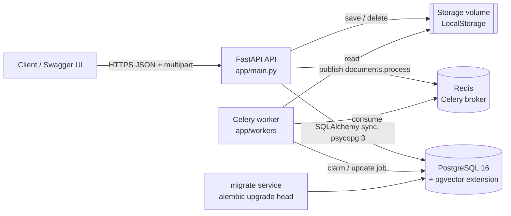
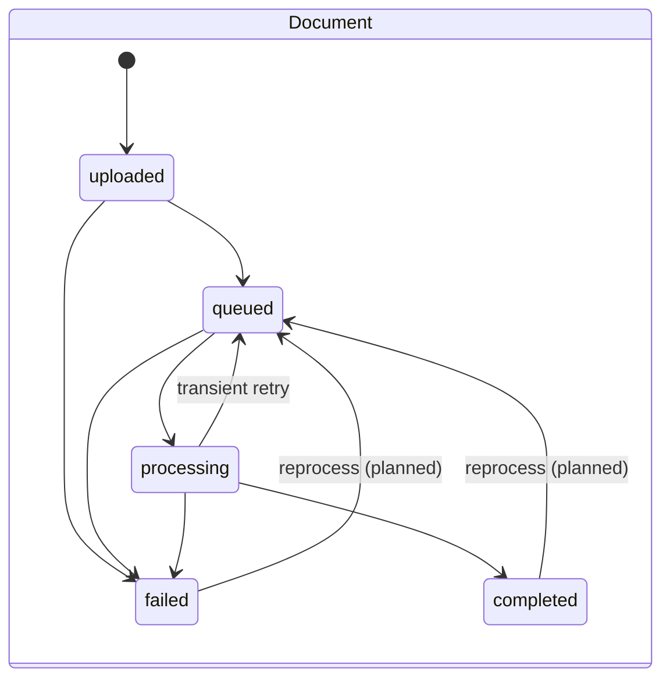
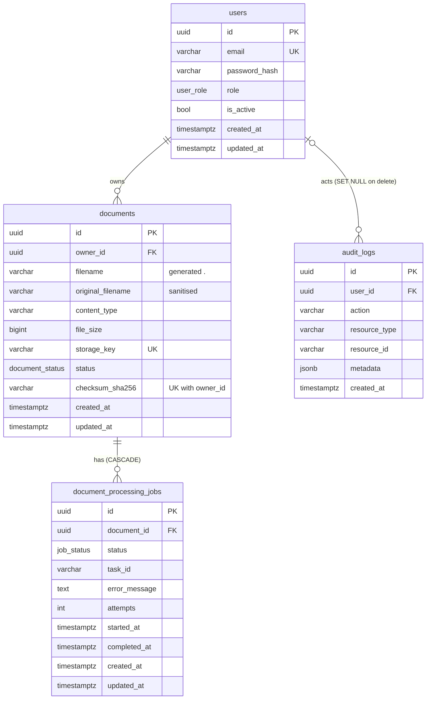

# Architecture

Status: DIP1 (backend foundation). Items marked *planned* do not exist in the code yet.

## System overview



## Layers and responsibilities

| Layer | Location | Responsibility |
| --- | --- | --- |
| Routes | `app/api/routes/` | HTTP shape only: parse input, call one service method, map to a response schema. |
| Dependencies | `app/api/dependencies/` | Session per request, current user / admin guards, pagination, service wiring. |
| Services | `app/services/` | Use cases and transaction boundaries (`commit`), audit logging, upload validation. |
| Repositories | `app/db/repositories/` | Queries. Document queries are always filtered by `owner_id`. Never commit. |
| Models | `app/db/models/` | SQLAlchemy 2.x typed ORM models. |
| Domain | `app/domain/` | Enums and the status state machine (allowed transitions). |
| Storage | `app/storage/` | `StorageService` interface + `LocalStorage` with traversal guard. |
| Workers | `app/workers/` | Celery app, task adapter, framework-free `DocumentProcessor`, pipeline steps. |
| Core | `app/core/` | Settings, security (Argon2, JWT), JSON logging, request context, errors, middleware. |

## Upload flow

```mermaid
sequenceDiagram
    autonumber
    participant C as Client
    participant A as API (DocumentService)
    participant S as LocalStorage
    participant D as PostgreSQL
    participant R as Redis
    C->>A: POST /documents (multipart, Bearer token)
    A->>A: sanitize filename, check extension + content type allow-list
    A->>S: save(key, chunks) - magic bytes, sha256, size limit while streaming
    alt too large / bad signature / empty
        S-->>A: abort, temp file removed
        A-->>C: 413 / 415 / 400
    end
    A->>D: duplicate check (owner_id, sha256)
    alt duplicate
        A->>S: delete(key)
        A-->>C: 409
    end
    A->>D: INSERT document (uploaded->queued), job (pending->queued, task_id), audit; COMMIT
    A->>R: publish documents.process(task_id)
    alt broker unavailable
        A->>D: job failed, document failed (safe message); COMMIT
    end
    A-->>C: 201 {id, status, job_id, job_status}
```

## Job flow

```mermaid
sequenceDiagram
    autonumber
    participant R as Redis
    participant W as Worker (DocumentProcessor)
    participant D as PostgreSQL
    participant S as Storage
    R->>W: documents.process(document_id, job_id, request_id)
    W->>D: SELECT job FOR UPDATE; skip if missing/terminal
    W->>D: job -> processing, attempts+1, started_at; document -> processing; COMMIT
    W->>S: pipeline steps (today: integrity_check = exists + size + sha256)
    alt success
        W->>D: job completed, completed_at; document completed; COMMIT
    else permanent error
        W->>D: job failed + safe error_message; document failed; COMMIT
    else transient error, retries left
        W->>D: job retrying; document queued; COMMIT
        W->>R: retry with exponential backoff
    end
```

### State machines (`app/domain/state_machine.py`)



Jobs: `pending -> queued -> processing -> {completed | failed | retrying}`,
`retrying -> {processing | failed}`, `pending/queued -> failed`. `completed` and `failed`
are terminal; reprocessing creates a new job row.

`completed` currently means *stored and integrity-verified*. No text extraction occurs
yet; DIP2 adds steps inside `processing`.

## Data model



Indexes: `users.email` (unique), `documents.owner_id`, `documents.status`,
`(owner_id, created_at)`, unique `(owner_id, checksum_sha256)`, unique `storage_key`,
`document_processing_jobs.document_id/status/task_id`, `audit_logs.user_id/action/created_at`.

## Authentication flow

1. `POST /auth/register` creates a user with role `user` (an incoming `role` field is ignored).
2. `POST /auth/login` (JSON) or `POST /auth/token` (OAuth2 form, used by Swagger *Authorize*)
   verifies the Argon2id hash. Unknown emails still run a dummy verification to keep timing
   similar; the error message is identical for unknown email and wrong password.
3. The API issues an HS256 JWT with `sub`, `role`, `type=access`, `jti`, `iss`, `iat`, `exp`.
4. `get_current_user` decodes the token (signature, expiry, issuer, required claims,
   type) and loads the user from the database. Role and `is_active` come from the
   database, so demotion/deactivation is effective immediately; a token for a deleted
   user is rejected.
5. `get_current_active_user` -> 403 for disabled accounts; `require_admin` -> 403 for non-admins.

Admins are created with `python -m app.cli create-admin --email ...` (password from
`ADMIN_PASSWORD` or an interactive prompt).

## Security boundaries

- **Tenant isolation**: every document query includes `owner_id`; other users' documents
  return 404 (indistinguishable from missing).
- **Input**: Pydantic validation; extension + content type allow-lists from config; magic
  byte check; size limit enforced while streaming; filename sanitised; storage keys
  generated server side; path traversal guard in `LocalStorage`.
- **Output**: no storage keys, generated filenames, Celery task ids or stack traces in
  responses; validation errors never echo submitted values.
- **Secrets**: only from environment; `JWT_SECRET` required, >= 32 chars, placeholder
  values rejected in production. Logs redact keys containing password/token/secret/authorization.
- **CORS**: explicit origins only; `*` rejected at startup.
- **Containers**: non-root user (uid 10001); Postgres/Redis are not published to the host.
- **Not yet**: rate limiting, account lockout, token revocation, refresh tokens, request
  body limit before multipart parsing, malware scanning (see DIP3 handoff).

## Observability

- JSON logs to stdout: `timestamp`, `level`, `logger`, `event`, `request_id`, plus
  `user_id` / `document_id` when known and event-specific fields.
- `X-Request-ID`: reused if it matches `^[A-Za-z0-9-]{8,64}$`, otherwise a UUID4 is
  generated; always echoed on the response and included in error bodies. The upload's
  request id is passed to the Celery task so worker logs share it.
- `GET /health` (liveness, no I/O), `GET /health/ready` (PostgreSQL `SELECT 1`, Redis
  `PING`, 503 if either fails).

## Integration points for later stages

| Stage | Hook | Location |
| --- | --- | --- |
| DIP2 | Add `PipelineStep`s (extract, chunk, embed) | `app/workers/pipeline.py::build_default_pipeline` |
| DIP2 | New tables (`document_chunks` with `vector` column) | new Alembic revision after `0001` |
| DIP2 | Search / ask routes and services | `app/api/routes/`, `app/services/`, register in `app/api/router.py` |
| DIP2 | Object storage backend | implement `StorageService`, select in `app/storage/factory.py` |
| DIP3 | Rate limiting middleware/dependency | `app/main.py::_register_middleware` |
| DIP3 | Metrics/tracing | `app/core/middleware.py`, `app/core/logging.py` |
| DIP3 | CI | commands listed in `DIP3_HANDOFF.md` |
