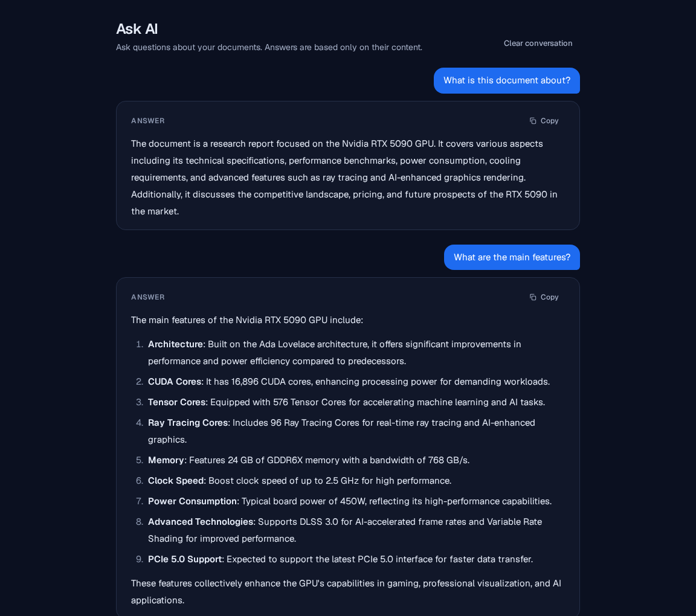
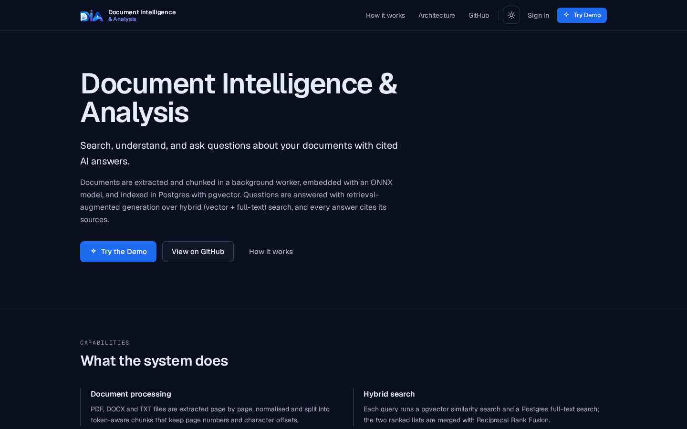
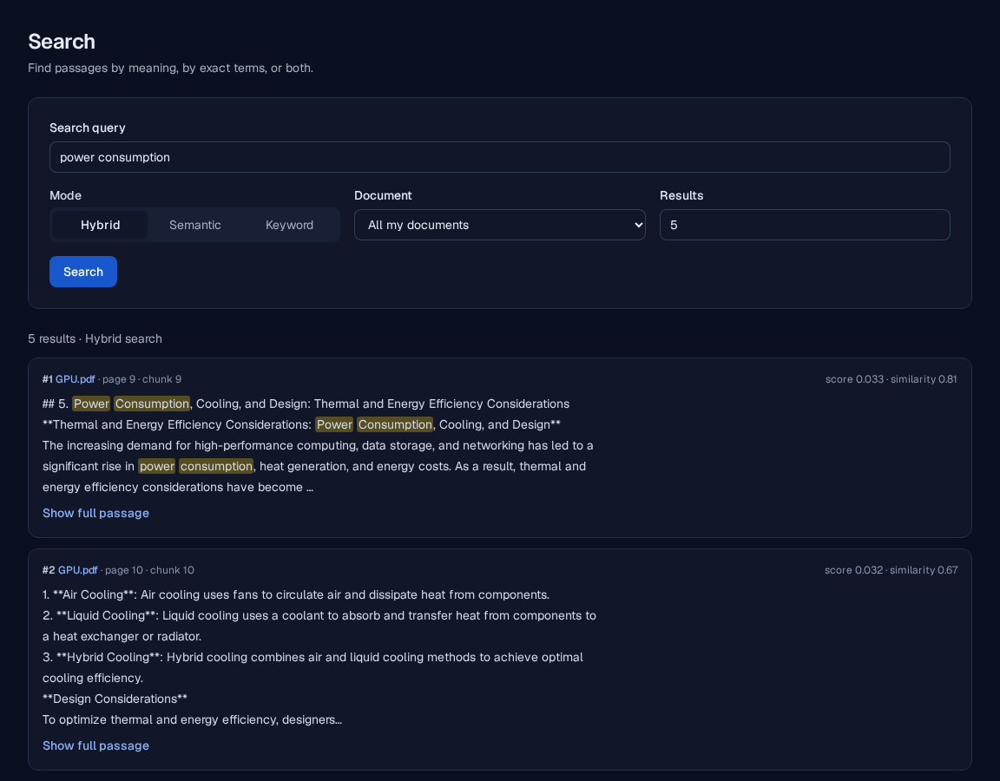
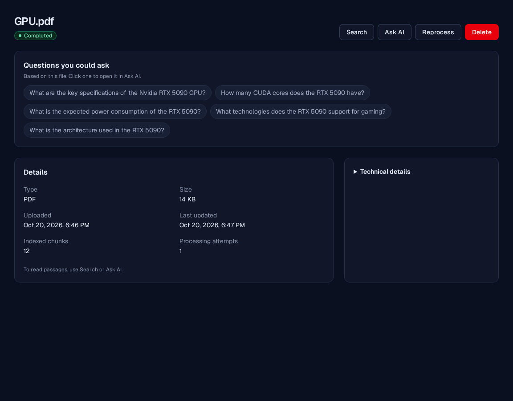
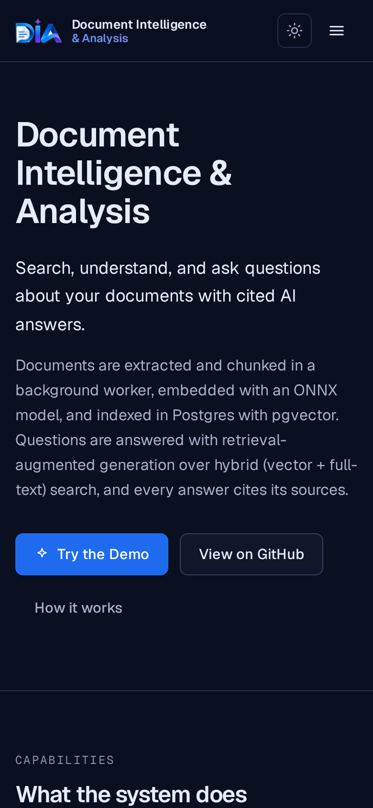
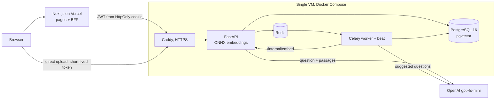

# Document Intelligence & Analysis

A retrieval-augmented question answering system for your own documents. Upload a PDF,
DOCX or TXT file, search it with hybrid vector and full-text retrieval, and ask questions
that are answered only from the document, with every answer checked against the passages
it was generated from.


**Live demo:** https://doc-intelligence-shahil.vercel.app
**Repository:** https://github.com/shahil5z/document-intelligence-analysis

The demo needs no sign-up: "Try the Demo" creates a temporary, isolated account limited
to 1 PDF of up to 5 MB and 3 questions, deleted after 24 hours. You can also register
with any e-mail address. The backend runs on a single free-tier VM, so the first request
after a quiet period can be slow.



## What it does

- Accepts PDF, DOCX and TXT uploads (up to 10 MB) and processes them in a background worker.
- Extracts text page by page, splits it into token-aware chunks and embeds each chunk.
- Searches across your documents by meaning, by exact terms, or both.
- Answers questions in formatted Markdown, using only passages retrieved from your documents.
- Says plainly when a document does not contain the answer instead of guessing.

## Why it is interesting

- **Hybrid retrieval.** Every query runs a pgvector cosine search (HNSW index) and a
  PostgreSQL full-text search (GIN index) and merges the two rankings with Reciprocal
  Rank Fusion, so paraphrases and exact names or numbers are both found without
  calibrating two score scales.
- **Grounded answers with citation validation.** The model must cite the numbered
  passages it used. The backend keeps only citations that refer to passages it actually
  sent, withholds any answer without a valid citation, and skips the model call entirely
  when no passage clears a similarity threshold. Citations are returned in the API
  response; the interface shows the clean answer.
- **One embedding model in memory.** `bge-small-en-v1.5` runs on ONNX Runtime inside the
  API process only. The Celery worker sends chunks to a private `/internal/embed`
  endpoint instead of loading a second copy, which keeps the stack inside 1 GB of RAM.
- **Asynchronous processing.** Uploads return immediately; a Celery worker runs
  extraction, chunking and embedding with an explicit job state machine, bounded retries
  and a scheduled task that re-queues stalled jobs.
- **Isolation and hardening.** Every repository query filters by owner in SQL (other
  users' documents return 404), uploads are checked by extension, MIME type, magic bytes
  and size, and `/internal/*`, `/metrics` and the OpenAPI docs are not reachable publicly.

## Key features

- Upload with live status: queued, processing, completed or failed.
- Hybrid, semantic and keyword search with page numbers for each passage.
- Ask AI: question bubbles and rendered Markdown answers (lists, tables, code) with a Copy button.
- Clean "not enough information" replies for questions the document does not cover.
- Suggested questions generated once per document after processing.
- Temporary demo accounts with server-side limits.
- Session token kept in an HttpOnly cookie by the Next.js server; never visible to page scripts.
- Light and dark themes, mobile layout.

## Product tour

| | |
| --- | --- |
|  |  |
| The landing page explains the pipeline and starts a demo session. | Hybrid search highlights matching terms and shows the page of each passage. |
|  |  |
| Each document shows its status, metadata and suggested questions. | The same app on a 390 px wide phone screen. |

## Architecture



## Retrieval and answer pipeline

1. The worker extracts text (pypdf, python-docx, plain text) with page numbers and
   normalises it.
2. Text is split into chunks of about 400 tokens with 60 tokens of overlap, keeping
   page and character offsets.
3. Each chunk is embedded (384 dimensions) and stored with a `vector` column (HNSW) and
   a generated `tsvector` column (GIN).
4. A question is embedded by the API; vector and full-text searches run over the user's
   completed documents only, and their rankings are fused with Reciprocal Rank Fusion.
5. If the best passage is below the similarity threshold, the API returns "not enough
   information" without calling the model.
6. Otherwise the passages are sent as numbered, untrusted sources with a structured-output
   schema; the model answers in Markdown and cites passage numbers.
7. The backend validates the cited numbers against the passages it sent, drops invalid
   ones, and withholds answers with no valid citation.
8. Citation markers are stripped from the answer text, and the clean Markdown is returned
   together with the citation metadata. The interface renders the Markdown only.

## Tech stack

| Area | Technologies |
| --- | --- |
| Backend | Python 3.12, FastAPI, Pydantic v2, SQLAlchemy 2, Alembic, gunicorn/uvicorn |
| Data and retrieval | PostgreSQL 16, pgvector, PostgreSQL full-text search, Redis 7 |
| AI | ONNX Runtime, BAAI bge-small-en-v1.5, OpenAI gpt-4o-mini |
| Jobs | Celery 5 with beat |
| Frontend | Next.js 16, React 19, TypeScript, Tailwind CSS 4, react-markdown |
| Infrastructure | Docker Compose, Caddy, Oracle Cloud VM, Vercel |
| Quality | pytest, ruff, mypy, ESLint, Playwright |

## Local development

Requirements: Docker with Compose, Python 3.12, Node.js 20.9+ and npm.

```bash
git clone https://github.com/shahil5z/document-intelligence-analysis.git
cd document-intelligence-analysis
python3 scripts/generate_env.py          # writes .env with random secrets
docker compose up --build -d             # postgres, redis, migrate, api, worker
curl -s http://localhost:8000/health/ready

cd frontend
cp .env.example .env.local
npm ci
npm run dev                              # http://localhost:3000
```

Without an OpenAI key everything except answers and suggested questions works; add
`-f docker-compose.stub-llm.yml` to use a local stub model. More detail:
[docs/local-development.md](docs/local-development.md).

## Configuration

Settings are read from environment variables. Templates with comments:
[.env.example](.env.example), [.env.production.example](.env.production.example) and
[frontend/.env.example](frontend/.env.example). The main variables are
`JWT_SECRET_KEY`, `POSTGRES_PASSWORD`, `REDIS_PASSWORD`, `INTERNAL_EMBED_SECRET`,
`OPENAI_API_KEY` and `CORS_ALLOWED_ORIGINS` for the backend, and `NEXT_PUBLIC_API_URL`
and `DIP_CLIENT_IP_SECRET` (server-only) for the frontend. See
[docs/configuration.md](docs/configuration.md).

## Security

- Passwords hashed with Argon2id; short-lived HS256 JWTs (30 minutes).
- The JWT lives in an HttpOnly, Secure, SameSite=Lax cookie set by the Next.js server;
  state-changing BFF calls require a CSRF header and a matching Origin.
- Owner filtering inside every SQL query; foreign document IDs return 404.
- Upload validation by extension, MIME type, magic bytes and streamed size limit.
- Redis-backed rate limits on registration, login, upload, search, ask and demo creation.
- Security headers (nosniff, frame denial, no-referrer, HSTS in production).
- Retrieved text is passed to the model as untrusted data; logs never contain document
  text, questions or answers.
- Caddy returns 404 for `/internal/*` and `/metrics`; API docs are disabled in production.
  Postgres and Redis are not exposed.

Details: [docs/security.md](docs/security.md).

## Testing

Run on 2026-10-21:

- Backend: `uv run pytest`: 553 passed, 11 skipped (S3 tests without an S3 server);
  `ruff check` and `mypy` pass.
- Frontend: `npm run lint`, `npm run typecheck` and `npm run build` pass.
- End to end: `scripts/e2e_prod_local.sh` (production compose stack, local HTTPS, stub
  model, Playwright): 22 of 22 passed.

See [docs/testing.md](docs/testing.md).

## Deployment

- **Frontend:** Vercel project with root directory `frontend/`; pushes to `main` deploy
  to production.
- **Backend:** one Oracle Cloud VM (1 GB RAM plus swap) running `docker-compose.prod.yml`
  with the `docker-compose.micro.yml` override: Caddy, API, Celery worker with embedded
  beat, PostgreSQL and Redis. Only SSH and HTTP(S) ports are open.

Guides: [docs/vercel-deployment.md](docs/vercel-deployment.md),
[docs/oracle-cloud-deployment.md](docs/oracle-cloud-deployment.md),
[docs/deployment-checklist.md](docs/deployment-checklist.md).

## Limitations

- Answers come from a language model and can be wrong or incomplete; verify important
  details in the document. Meta-questions such as "what is not covered" are answered
  from retrieved excerpts and are less reliable.
- No OCR: scanned PDFs without a text layer fail, and complex tables or multi-column
  layouts may be extracted imperfectly.
- The embedding model is English-focused.
- Single VM with local storage and no failover; the first request after a restart is slow.
- Each question is answered independently; follow-ups do not use earlier turns as context.

## Documentation

- [Architecture](docs/architecture.md)
- [Document processing](docs/document-processing.md)
- [Retrieval](docs/retrieval.md) and [RAG](docs/rag.md)
- [Demo mode](docs/demo-mode.md)
- [Security](docs/security.md)
- [Architecture decision records](docs/adr/)

## Author

Shohrab Haque Shahil. Designed and built this system end to end, from the retrieval
backend to the deployment.

## License

[MIT](LICENSE)
