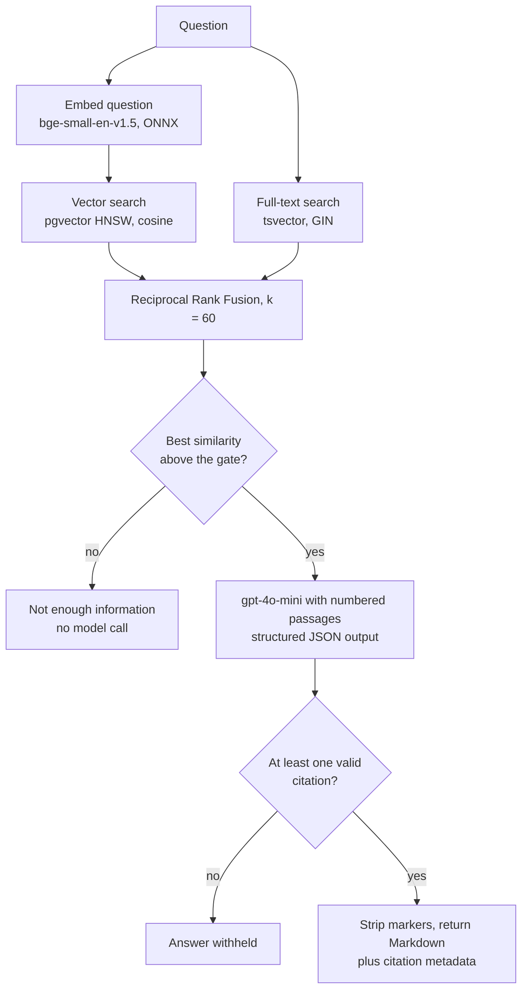
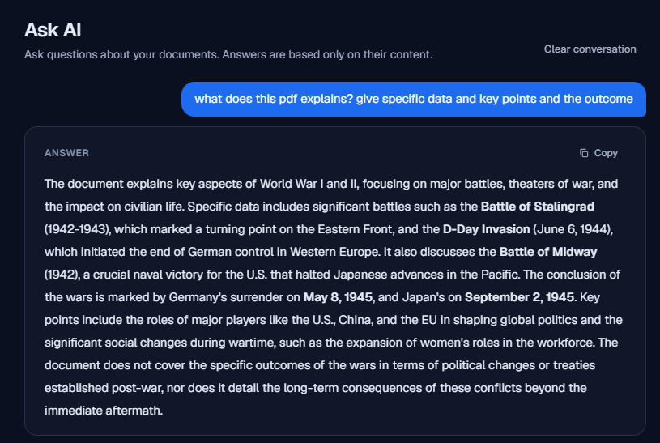
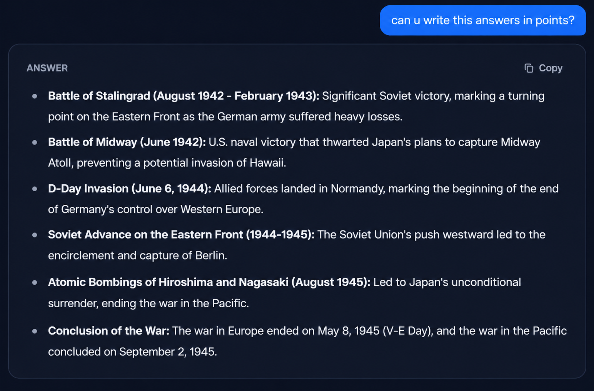
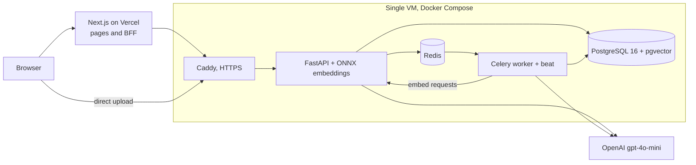

<p align="center">
  
</p>

<h1 align="center">Document Intelligence &amp; Analysis</h1>

Upload a PDF, DOCX or TXT file, search it with hybrid vector and full-text retrieval, and
ask questions that are answered only from the document, with each answer checked against
the passages it was generated from.


<p align="center">
  <a href="https://doc-intelligence-shahil.vercel.app">Live Demo</a> |
  <a href="#documentation">Documentation</a> |
  <a href="docs/architecture.md">Architecture</a> |
  <a href="docs/retrieval.md">Retrieval</a>
</p>

The live demo needs no sign-up. "Try the Demo" creates a temporary account limited to
one PDF of up to 5 MB and three questions; it is deleted after 24 hours.

## What it is

A full-stack retrieval-augmented generation (RAG) system: a FastAPI backend with a
Celery worker, PostgreSQL with pgvector, and a Next.js frontend.

## Why it matters

General chat models answer from what they were trained on. This system answers from the
file you uploaded, and replies that it could not find enough information instead of
guessing when the file does not support an answer.

## What is technically interesting

Retrieval combines two independent rankings, every answer has to cite the passages it
used, and those citations are checked on the server before anything reaches the user.
The whole stack runs on a single 1 GB VM.

## Retrieval pipeline



**Why hybrid retrieval?** Vector search finds paraphrases but can miss exact names,
model numbers and figures; full-text search finds those but misses rewording. Each query
runs both over the user's completed documents, and Reciprocal Rank Fusion merges the
two lists by rank (`1 / (60 + rank)`), so the different score scales never have to be
calibrated against each other.

**Citation grounding.** Retrieved passages are sent to the model as numbered, untrusted
sources, and the model must cite the numbers it relied on.

- Citations that do not refer to a passage actually sent are removed.
- An answer with no valid citation is withheld.
- If the best passage is below the similarity gate (0.48 by default, 0.20 when the
  question is scoped to one document or asks about the document as a whole), the API
  returns "not enough information" without calling the model. The model can also
  decline on its own when the passages do not answer the question.
- After validation the markers are stripped from the text. The interface shows clean
  Markdown; the API response still carries the citations (document, page, passage).

This reduces unsupported answers but does not eliminate them: the model can still
misread a passage it correctly cites.

## Technical highlights

| Area | Detail |
| --- | --- |
| Retrieval | pgvector HNSW and PostgreSQL GIN full-text indexes fused with Reciprocal Rank Fusion |
| Evidence | Similarity gate before the model call, server-side citation validation, withholding without a valid citation |
| Inference | `bge-small-en-v1.5` (384 dimensions) on ONNX Runtime, loaded once in the API; the worker embeds through it |
| Processing | Token-based chunks (400 tokens, 60 overlap) built from whole sentences; Celery jobs with explicit states and bounded retries (3 by default, exponential backoff) |
| Security | Argon2id passwords, HttpOnly session cookie through a Next.js BFF, owner filtering in every query |
| Deployment | Next.js on Vercel; API, worker, PostgreSQL, Redis and Caddy in Docker Compose on one VM |

## Product tour

**01. Landing page.** Explains the pipeline and starts a demo session without sign-up.


**02. Document page.** Shows processing status, metadata and questions suggested from the file.


**03. Hybrid search.** Highlights matching terms and shows the page and similarity of each passage.


**04. Answer formats.** Questions about a World War history PDF: a summary comes back as a paragraph with key dates in bold, and asking for points returns battles and dates as a bulleted list.





## Architecture



The browser talks to the Next.js server, which keeps the session token in an HttpOnly
cookie and forwards requests to the API with it; only file uploads go directly to the
API, with a short-lived upload token. The API stores the file, records a job and queues
it in Redis. The Celery worker extracts text, chunks it, gets embeddings from the API
and writes chunks with their vectors to PostgreSQL, then generates suggested questions.
Search and ask run synchronously in the API. Details:
[docs/architecture.md](docs/architecture.md).

## Tech stack

| Layer | Technologies |
| --- | --- |
| Backend | Python 3.12, FastAPI, Pydantic v2, SQLAlchemy 2, Alembic |
| Data | PostgreSQL 16, pgvector, PostgreSQL full-text search, Redis |
| AI | ONNX Runtime, BAAI bge-small-en-v1.5, OpenAI gpt-4o-mini |
| Jobs | Celery with beat |
| Frontend | Next.js 16, React 19, TypeScript, Tailwind CSS 4, react-markdown |
| Infrastructure | Docker Compose, Caddy, Vercel |

## Local development

Requirements: Docker with Compose, Python 3.12, Node.js 20.9 or newer.

```bash
python3 scripts/generate_env.py            # writes .env with random secrets
docker compose up --build -d
curl -s http://localhost:8000/health/ready

cd frontend && cp .env.example .env.local && npm ci && npm run dev   # http://localhost:3000
```

Without an OpenAI key everything except answers works. For key-free answers, add
`-f docker-compose.yml -f docker-compose.stub-llm.yml` and set `OPENAI_API_KEY` to any
non-placeholder string. Full guide, Windows commands and checks:
[docs/local-development.md](docs/local-development.md).

## Security

- Argon2id password hashing; JWTs expire after 30 minutes.
- The JWT lives in an HttpOnly, Secure, SameSite=Lax cookie set by the Next.js server;
  state-changing requests need a CSRF header and a matching Origin.
- Every document query filters by owner; another user's document returns 404.
- Uploads are checked by extension, MIME type, magic bytes and a streamed size limit.
- Redis-backed rate limits on login, registration, upload, search, ask and demo creation.
- Retrieved text is treated as untrusted input; logs contain no document text, questions
  or answers.
- Internal endpoints, metrics and API docs are not publicly reachable.

Details: [docs/security.md](docs/security.md).

## Limitations

- Answers can still be wrong or incomplete; verify important details in the document.
  Questions about what a document does *not* cover are answered from a few retrieved
  passages and are less reliable.
- No OCR: scanned PDFs without a text layer fail, and complex layouts may extract poorly.
- The embedding model is English-focused.
- One VM with local storage and no failover.
- Each question is answered on its own; earlier turns are not used as context.

## Documentation

| Document | Covers |
| --- | --- |
| [architecture.md](docs/architecture.md) | Components, flows, state machines, data model |
| [document-processing.md](docs/document-processing.md) | Extraction, normalisation, chunking |
| [retrieval.md](docs/retrieval.md) | Vector, full-text and hybrid search |
| [rag.md](docs/rag.md) | Prompting, evidence gate, citation validation |
| [demo-mode.md](docs/demo-mode.md) | Temporary demo accounts and limits |
| [security.md](docs/security.md) | Threat model and controls |
| [configuration.md](docs/configuration.md) | Environment variables |
| [local-development.md](docs/local-development.md) | Running locally |
| [testing.md](docs/testing.md) | Test layout, commands, results |
| [production-deployment.md](docs/production-deployment.md) | Production stack, with [Oracle Cloud](docs/oracle-cloud-deployment.md) and [Vercel](docs/vercel-deployment.md) guides |
| [adr/](docs/adr/) | Architecture decision records |

## Author

Designed and developed by **Shohrab Haque Shahil**

[LinkedIn](https://www.linkedin.com/in/shohrab-haque) | [Website](https://shahil-personal.vercel.app)

## License

[MIT](LICENSE)
