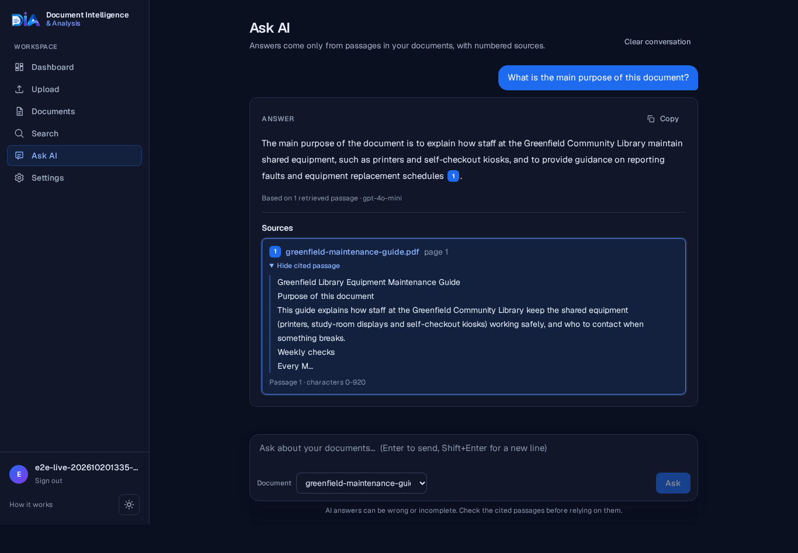
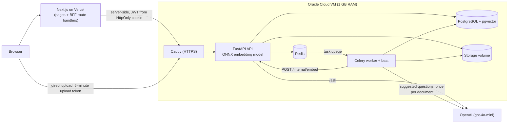
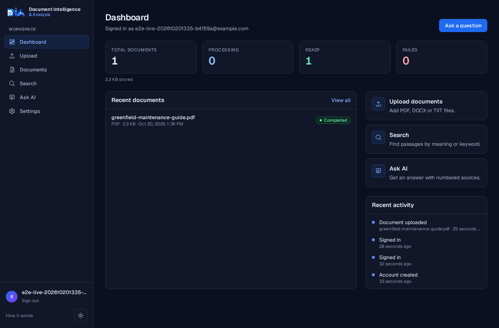
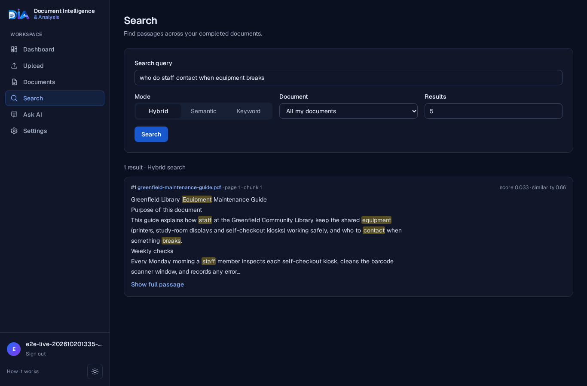

# Document Intelligence & Analysis

Upload PDF, DOCX or TXT files, search them by meaning or by keyword, and ask questions
that are answered only from your own documents, with numbered citations back to the
passages that were used.

- **Live demo:** https://doc-intelligence-shahil.vercel.app

Register with any e-mail address (no verification) or use the temporary demo account
on the landing page. The demo backend runs on a free 1 GB VM, so the first request
after a quiet period can take a few seconds.

## Key features

- Accounts with Argon2id password hashing and short-lived JWTs, kept server-side in an
  HttpOnly cookie by the Next.js frontend.
- Uploads up to 10 MB, checked by extension, MIME type and magic bytes, with per-user
  duplicate detection.
- Background processing (extract, clean, chunk, embed, index) in a Celery worker, with
  a visible status per document and bounded retries.
- Three search modes: semantic (pgvector), keyword (PostgreSQL full-text) and hybrid
  (reciprocal rank fusion).
- AI question answering (RAG) with validated citations and the cited passage shown
  next to the answer.
- Suggested questions generated from each uploaded document (one small LLM call per
  document, after processing), with generic suggestions as a fallback.
- Every query is scoped to the document owner in SQL; other users' documents return 404.
- Rate limits, security headers, JSON logs without secrets or document text.

## Architecture

The browser never talks to Postgres, Redis or the internal endpoint: Caddy publishes
only the API and returns 404 for `/internal/*` and `/metrics`.

## Tech stack

- **Backend:** Python 3.12, FastAPI, Pydantic v2, SQLAlchemy 2, Alembic, PyJWT, pwdlib
  (Argon2id), pypdf, python-docx, ONNX Runtime + tokenizers, gunicorn/uvicorn, uv.
- **Data:** PostgreSQL 16 with pgvector (HNSW) and full-text search, Redis 7.
- **Jobs:** Celery 5 (worker with beat).
- **Frontend:** Next.js 16 (App Router), React 19, TypeScript, Tailwind CSS 4.
- **AI:** `BAAI/bge-small-en-v1.5` embeddings (384 dimensions) via ONNX Runtime;
  OpenAI `gpt-4o-mini` for answers and suggested questions.
- **Ops:** Docker Compose, Caddy, Oracle Cloud (backend), Vercel (frontend).
- **Quality:** pytest, ruff, mypy (strict), Playwright, gitleaks.

## How it works

1. **Upload.** The browser gets a 5-minute upload-only token from the frontend server
   and sends the file straight to the API (Vercel functions cap request bodies at
   about 4.5 MB). The API validates and stores the file, creates a job and returns at
   once.
2. **Processing.** The worker extracts text (pypdf, python-docx, plain text),
   normalises it and splits it into token-aware chunks (400 tokens, 60 overlap).
3. **Embedding and indexing.** Chunks are embedded and stored with a `vector(384)`
   column (HNSW cosine index) and a generated `tsvector` column (GIN index).
4. **Suggested questions.** The worker sends the start of the text (about 10,000
   characters) to `gpt-4o-mini` once and stores 3-5 questions on the document. If the
   call fails or no key is set, the job still completes and the UI shows generic
   suggestions.
5. **Status.** The frontend polls the document and shows queued, processing,
   completed or failed.
6. **Search and ask.** Queries are embedded by the API and run against the user's
   completed documents only.

## Search modes

- **Semantic:** nearest chunks by cosine similarity. Finds paraphrases, weaker for
  exact codes and names.
- **Keyword:** PostgreSQL full-text search. Exact terms, no synonyms.
- **Hybrid** (default): runs both and merges the rankings with reciprocal rank fusion.

## AI Q&A and citations

`/ask` retrieves passages, drops weak ones below a similarity threshold, and sends the
rest to the LLM as numbered sources that are treated as data, not instructions. If
nothing relevant is found, it answers "insufficient evidence" without calling the LLM.
The model must cite sources; the backend keeps only citation numbers that were really
in the prompt and returns each with the document name, page and passage text. The UI
shows the answer with clickable citation markers and the source passages under it.
A citation shows which passage the model used; it does not prove the claim.

## Authentication

- Register/login go through Next.js route handlers, which call the API server-side and
  store the JWT in an HttpOnly, Secure, SameSite=Lax cookie. Page scripts never see it.
- Other API calls go through `/api/proxy/*` (an allow-list), with a CSRF header and
  origin check on writes.
- Tokens are signed (HS256), carry `sub`, `role`, `jti`, `iat`, `exp`, `iss`, and last
  30 minutes. The user is reloaded on every request.
- Logout deletes the cookie; protected pages redirect to `/login` and the API answers
  401 without a token.

## Background processing

Redis is the Celery broker and also holds the rate-limit counters. Each document has a
processing job with an explicit state machine: transient errors are retried a bounded
number of times, permanent ones (for example a PDF without a text layer) fail with a
clear message, and a beat task resets jobs left behind by a crashed worker. On the
1 GB VM beat runs inside the worker process to save memory.

## ONNX optimization

The first deployment used PyTorch + sentence-transformers, with one model copy in the
API and another in the worker. On the 1 GB VM that did not fit. The model now runs as
its fp32 ONNX export on ONNX Runtime, and only the API loads it; the worker sends chunk
batches to the API's private `POST /internal/embed` (shared-secret header) and counts
tokens with the tokenizer file alone.

Measured on the production VM:

| | Before (PyTorch) | After (ONNX) |
| --- | --- | --- |
| Processing a small PDF | failed after ~4 min | completed in 31 s |
| Docker image | 2.23 GB | 712 MB |
| Image build on the VM | 21 min | 12 min |
| Embedding model copies in memory | 2 | 1 |

On the live demo a one-page PDF went from upload to completed in about 25 s.

## Technical decisions

1. **FastAPI:** typed request/response models, dependency injection for auth and DB
   sessions, OpenAPI for free.
2. **PostgreSQL + pgvector:** vectors live next to the relational data, so the owner
   filter and the vector search are one SQL query, with no second database to sync.
3. **Redis + Celery:** extraction and embedding are too slow for a request; Celery
   adds retries and time limits, and Redis also backs the shared rate limits.
4. **Hybrid search:** semantic search misses exact terms and keyword search misses
   paraphrases; rank fusion covers both without tuning score scales.
5. **RAG with validated citations:** answers come only from retrieved passages, and
   citations not in the prompt are removed.
6. **ONNX Runtime:** same model and embeddings as PyTorch at a fraction of the image
   size and memory, no torch dependency.
7. **Single model copy:** the API owns the model and the worker calls it internally,
   so memory holds one copy instead of two.
8. **Oracle Cloud:** an always-free VM is enough for a demo backend with Postgres,
   Redis and the worker.
9. **Vercel:** hosts the Next.js frontend and its server-side BFF; pushes to `main`
   deploy automatically.
10. **Designing for 1 GB RAM:** explicit container memory limits, one gunicorn worker,
    beat inside the worker, lazy model loading and swap.

## Deployment architecture

- **Frontend:** Vercel project with root directory `frontend/`, linked to this repo
  (push to `main` deploys). `NEXT_PUBLIC_API_URL` points at the API;
  `DIP_CLIENT_IP_SECRET` (server-only) lets the BFF pass the browser IP for per-IP
  limits.
- **Backend:** one Oracle Cloud VM (1 GB RAM + 4 GB swap) running
  `docker-compose.prod.yml` with the `docker-compose.micro.yml` override: Caddy, API,
  worker, migrate job, Postgres and Redis. Only ports 22/80/443 are open.
- Demo cost limits: `/ask` 10 per hour and 30 per day per user; demo accounts get 3
  questions, with at most 50 demo accounts per day.

Guides: [docs/vercel-deployment.md](docs/vercel-deployment.md),
[docs/oracle-cloud-deployment.md](docs/oracle-cloud-deployment.md),
[docs/production-deployment.md](docs/production-deployment.md),
[docs/configuration.md](docs/configuration.md).

## Known limitations

- **No OCR:** scanned PDFs without a text layer fail. DOCX reads body paragraphs and
  tables only; no legacy `.doc`.
- **Local volume storage** on the single VM (S3/OCI storage is implemented but not used
  in the demo); no replication or failover.
- **1 GB VM:** the first embedding after a restart loads the model (about 12 s), swap
  is in use, and the first request after idle can be slow. Document embedding and API
  requests share one CPU.
- **Metrics** have no authentication; they are only kept private by Caddy and the
  internal network.
- **Sessions:** no refresh tokens, no token revocation and no account lockout; logging
  out removes the cookie, and the token expires after 30 minutes.
- **Rate limits** are fixed-window. Registration needs no e-mail verification.
- Retrieval quality was evaluated on a small synthetic set (18 queries, 6 documents).
- The Impressum and privacy pages still contain placeholders.

## Future improvements

- OCR for scanned PDFs.
- Object storage and a larger or second VM.
- Refresh tokens with server-side revocation.
- Streaming answers.
- A larger retrieval evaluation set and optional reranking on bigger hardware.

## Author

Designed and developed by Shohrab Haque Shahil

## License

[MIT](LICENSE), (c) 2026 Shohrab Haque Shahil.
