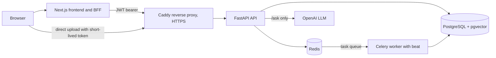

# Document Intelligence & Analysis

Upload PDF, DOCX and TXT files, search them (semantic, keyword or hybrid), and ask
questions that are answered only from your own documents, with numbered citations to
the passages that were used.

## What it is

A multi-user document question-answering system built around retrieval-augmented
generation (RAG). A FastAPI backend stores documents and their chunks in PostgreSQL
with pgvector; a Celery worker extracts, chunks and embeds text in the background; a
Next.js frontend talks to the API through its own server-side routes. Every query is
scoped to the document owner inside SQL, and answers cite the retrieved passages.

## Why I built it

I wanted a project that goes past a notebook RAG demo: real accounts, background jobs
that can fail and be retried, a database that does both vector and full-text search,
answers that can be checked against their sources, tests against a real database, and
a deployment setup I could run on a small cloud VM.

## Features

- Accounts: register / login with Argon2id password hashing and JWT access tokens,
  user and admin roles, admin endpoints, audit log.
- Uploads: PDF, DOCX and TXT up to 10 MB, checked by extension, MIME type and magic
  bytes; per-user duplicate detection; storage on a local volume or any S3-compatible
  service (including OCI Object Storage).
- Background processing: Celery pipeline with an explicit job state machine, bounded
  retries, terminal failure states and a stale-job reconciler run by Celery beat.
- Retrieval: semantic (pgvector HNSW), keyword (PostgreSQL full-text search) and hybrid
  (reciprocal rank fusion), with optional cross-encoder reranking (off by default).
- Question answering (`/ask`): grounded answers with validated `[S#]` citations; returns
  "insufficient evidence" without calling the LLM when retrieval is weak; returns 503
  when no LLM is configured.
- Demo mode: a temporary account (1 PDF, 3 questions, removed after 24 hours) that can
  be converted into a normal account ([docs/demo-mode.md](docs/demo-mode.md)).
- Hardening: Redis-backed rate limits, request body limits, security headers,
  Prometheus metrics, JSON logs that exclude secrets and document text.
- Frontend: dashboard, upload with progress, document list and detail, search, ask
  with clickable citations, light/dark theme, mobile layout.

## Architecture

Caddy is used in the production compose file; in local development the frontend calls
the API directly on port 8000. Inside the API the layers are routes -> services
(transaction boundaries) -> repositories (owner-scoped queries) -> SQLAlchemy models.
More detail: [docs/architecture.md](docs/architecture.md) and the decision records in
[docs/adr/](docs/adr).

## Tech stack

- Backend: Python 3.12, FastAPI, Pydantic v2, SQLAlchemy 2 (sync, psycopg 3), Alembic,
  PyJWT, pwdlib (Argon2id), pypdf, python-docx, ONNX Runtime + tokenizers (CPU, no PyTorch),
  boto3, gunicorn + uvicorn workers, uv.
- Data: PostgreSQL 16 with pgvector (HNSW) and full-text search, Redis 7.
- Jobs: Celery 5 (worker + beat).
- Frontend: Next.js (App Router), TypeScript, Playwright for end-to-end tests.
- Ops: Docker Compose, Caddy, shell scripts for deploy / backup / restore / health.
- Quality: pytest, ruff, mypy (strict).

## Document pipeline

1. **Upload**: `POST /documents` validates the file, stores it, creates a document row
   and a processing job, and queues a Celery task. The response returns immediately.
2. **Async processing**: the worker picks up the job and moves it through explicit
   stages; failures are retried a bounded number of times, then marked failed. A beat
   task resets jobs that got stuck (for example after a worker crash).
3. **Extraction**: pypdf for PDFs, python-docx for DOCX (body paragraphs and tables),
   plain decoding for TXT. Scanned PDFs without a text layer fail with a clear message.
4. **Cleaning and chunking**: whitespace/Unicode normalisation, then token-aware chunks
   (default 400 tokens with 60 overlap, capped per document).
5. **Embeddings**: `BAAI/bge-small-en-v1.5` (384 dimensions), its fp32 ONNX export run
   with ONNX Runtime on CPU (CLS pooling, L2 normalisation; no PyTorch in the image).
   On the 1 GB VM a single model copy lives in the API: the API embeds queries, and the
   worker sends document chunks to the API's internal `POST /internal/embed`
   (shared-secret header, blocked at Caddy). Chunking counts tokens with the model's
   tokenizer only.
6. **Indexing**: chunks are stored in `document_chunks` with a `vector(384)` column
   (HNSW cosine index) and a generated `tsvector` column (GIN index).
7. **Retrieval**: semantic, keyword or hybrid search over the user's completed
   documents (see below).
8. **RAG**: `/ask` retrieves passages, drops weak ones by a similarity threshold, and
   builds a prompt where the passages are numbered sources and treated as data, not
   instructions.
9. **Answer with citations**: the LLM returns an answer that cites `[S1]`, `[S2]`, ...;
   citations are validated against the passages that were actually sent, and invalid
   ones are removed.

Details: [docs/document-processing.md](docs/document-processing.md),
[docs/retrieval.md](docs/retrieval.md), [docs/rag.md](docs/rag.md).

## Why Redis and Celery

Extraction and embedding take seconds to minutes and use a lot of CPU and memory, so
they should not run inside an HTTP request. Celery gives a separate worker process with
retries and time limits, and beat runs periodic jobs (stale-job reconciler, demo
cleanup). Redis is the Celery broker and also stores the rate-limit counters, so limits
are shared across API processes.

## Why PostgreSQL + pgvector

The documents, users, jobs and chunks are relational data that need transactions and
owner scoping. pgvector keeps vectors in the same database, so one SQL query can apply
the owner filter and the vector search together, and PostgreSQL full-text search covers
keyword retrieval. That avoids running and syncing a separate vector database.

## Authentication

- Passwords are hashed with Argon2id.
- Login returns a signed JWT access token (HS256 by default) with `sub`, `role`,
  `type`, `jti`, `iat`, `exp` and `iss`; all of these are required when the token is
  decoded, and the algorithm and issuer are pinned. Default lifetime is 30 minutes.
- The user is reloaded from the database on every request, so deleted or deactivated
  users are rejected.
- A separate short-lived (300 s) upload token is only valid for `POST /documents`, so
  the browser can upload directly to the API.
- In the browser the Next.js server stores the token in an HttpOnly cookie and proxies
  API calls, with a CSRF header and origin check
  ([ADR-006](docs/adr/ADR-006-frontend-auth-bff.md)).
- There are no refresh tokens and no token revocation list; a session ends when the
  token expires.
- Another user's documents return 404, not 403.

## Semantic search vs keyword vs hybrid vs question answering

- **Semantic**: embeds the query and finds chunks with the closest vectors (cosine).
  Good for paraphrases, weaker for exact names or codes.
- **Keyword**: PostgreSQL full-text search (`tsvector` with `plainto_tsquery`). Good
  for exact terms, misses synonyms.
- **Hybrid**: runs both and merges the rankings with reciprocal rank fusion.
- **Question answering (`/ask`)**: uses retrieval to collect evidence and then asks the
  LLM to write an answer from those passages only, with citations. Search returns
  passages; `/ask` returns an answer.

## Citations

Each passage sent to the LLM gets an id (`S1`, `S2`, ...) linked to a document and
chunk. After the LLM replies, the backend keeps only citation ids that were in the
prompt and returns them with document name, chunk position and the passage text, so the
frontend can show what each claim is based on. This shows which passage the model
pointed at; it does not prove the passage supports the claim.

## Environment variables

All variables and defaults are in [docs/configuration.md](docs/configuration.md), with
templates in [.env.example](.env.example),
[.env.production.example](.env.production.example) and
[frontend/.env.example](frontend/.env.example). The templates contain placeholders
only; real `.env` files are git-ignored.

## Production / deployment architecture

`docker-compose.prod.yml` runs on one VM: Caddy (the only service with published ports,
80/443, automatic HTTPS, `/metrics` blocked), the API under gunicorn, a Celery worker,
Celery beat, a one-shot migration job, and PostgreSQL + Redis on an internal network.
The frontend is meant for Vercel. `docker-compose.micro.yml` is an override for a
1 GB VM (smaller memory limits, one API worker, beat inside the worker,
one embedding model copy in the API with the worker on `EMBEDDING_PROVIDER=remote`,
`deploy/caddy/Caddyfile.micro`). Guides:
[docs/production-deployment.md](docs/production-deployment.md),
[docs/oracle-cloud-deployment.md](docs/oracle-cloud-deployment.md),
[docs/vercel-deployment.md](docs/vercel-deployment.md),
[docs/deployment-checklist.md](docs/deployment-checklist.md),
[docs/backup-and-recovery.md](docs/backup-and-recovery.md).

## Known limitations

- On a 1 GB VM memory is tight (about 300 MB available at idle, swap in use): the
  first embedding after a restart loads the model (about 12 s) and the first searches
  after idle can take seconds while pages are swapped back in. Embedding runs inside
  the single API process, so document embedding and requests share one CPU.
- `/metrics` has no authentication; it is only protected by not being exposed (Caddy
  returns 404 for it and it is reachable only inside the compose network).
- No refresh tokens, token revocation or account lockout.
- No OCR: scanned PDFs fail. DOCX extraction reads body paragraphs and tables only (no
  headers/footers, footnotes, comments or text boxes; no legacy `.doc`).
- Retrieval quality was evaluated on 18 synthetic queries over 6 short documents; the
  evidence threshold was calibrated only on that set.
- Live OpenAI answering is not verified in production.
- Single VM: no replication or failover; fixed-window rate limits.

## Author

Designed and developed by Shohrab Haque Shahil

## License

[MIT](LICENSE), (c) 2026 Shohrab Haque Shahil.
