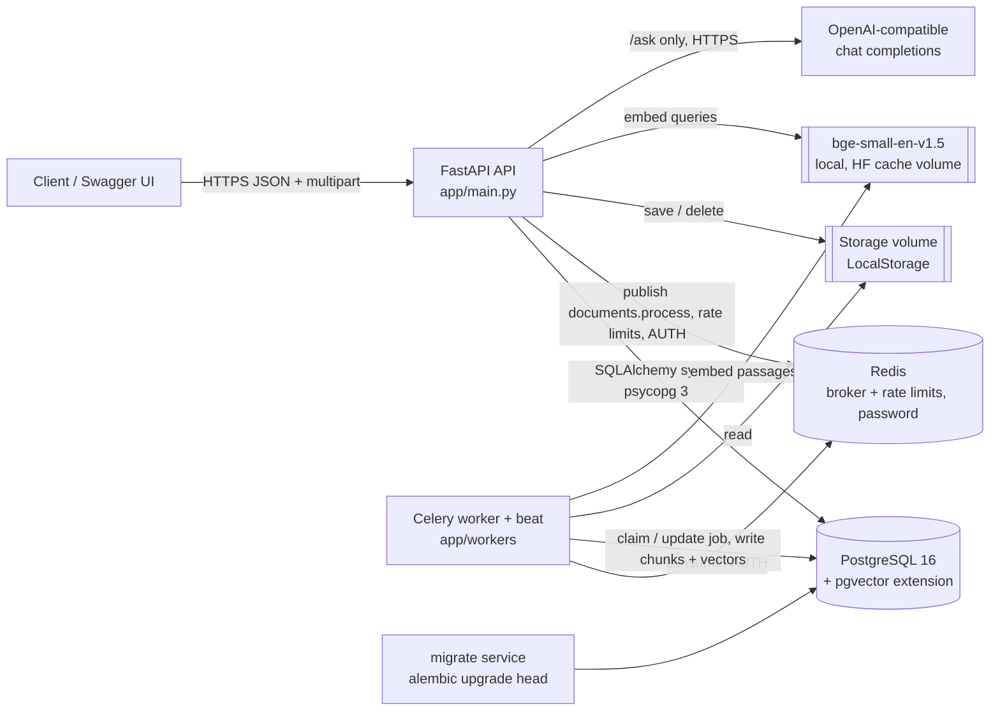
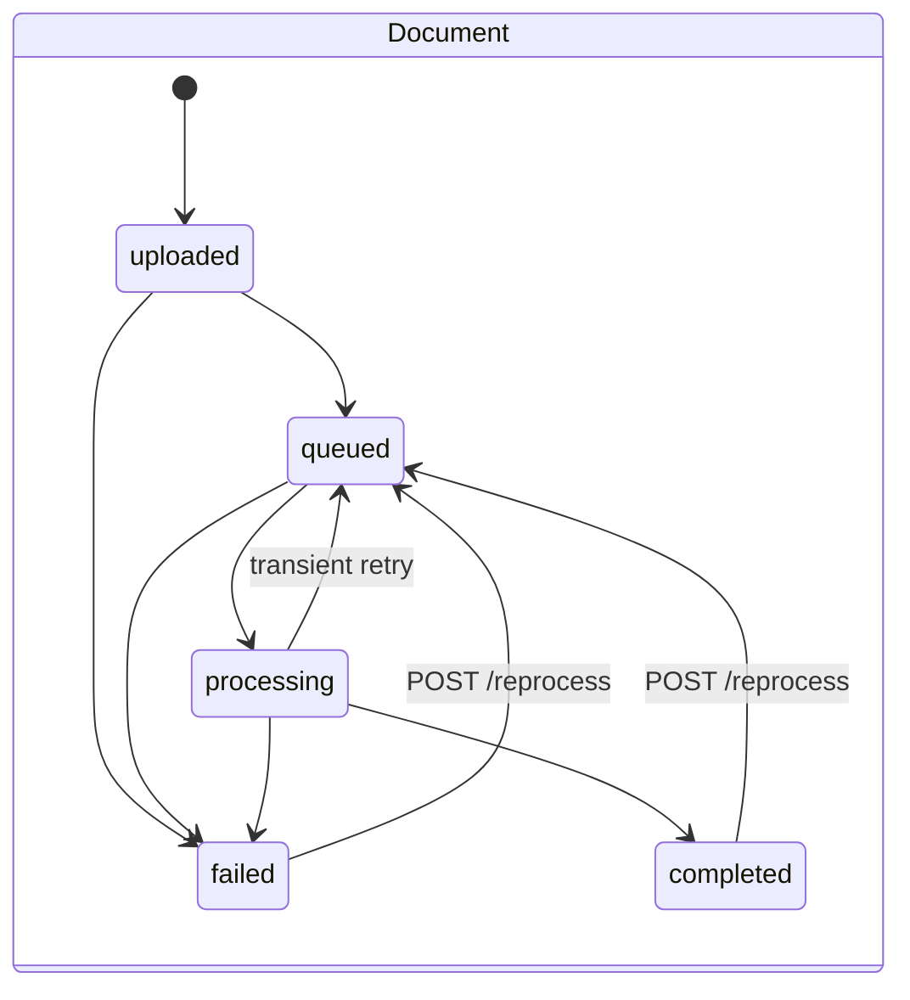
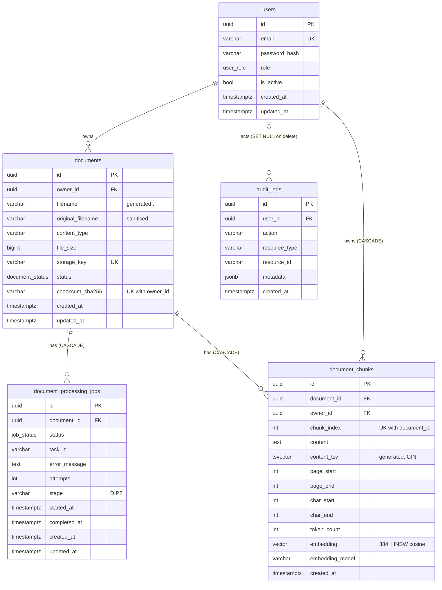

# Architecture

Status: DIP1 (backend foundation) + DIP2 (document intelligence: extraction, chunking,
embeddings, retrieval, `/ask`) + DIP3 (production hardening). Details of DIP2 parts: [document-processing.md](document-processing.md),
[retrieval.md](retrieval.md), [rag.md](rag.md), [SECURITY.md](SECURITY.md). DIP3:
[observability.md](observability.md), [testing.md](testing.md),
[deployment.md](deployment.md), [performance.md](performance.md).

## Request path (DIP3)

Middleware, outermost first (`app/main.py::_register_middleware`):

1. `RequestContextMiddleware` - request id, access log, HTTP metrics labelled by route
   template (`/documents/{document_id}`), never by raw path.
2. `SecurityHeadersMiddleware` - nosniff, `X-Frame-Options: DENY`,
   `Referrer-Policy: no-referrer`, `Cross-Origin-Resource-Policy: same-origin`; HSTS in production.
3. `BodySizeLimitMiddleware` - 413 from `Content-Length` before the app runs; for
   chunked bodies counts bytes and replaces the response with 413 once the limit is
   passed. Limit: `MAX_REQUEST_BODY_BYTES` (1 MiB), or `MAX_UPLOAD_SIZE_BYTES` +
   `UPLOAD_BODY_OVERHEAD_BYTES` for `POST /documents`.
4. `CORSMiddleware` - configured origins only; exposes `X-Request-ID` and `Retry-After`.

Rate limits are FastAPI dependencies (`app/api/dependencies/rate_limit.py`): per client
IP for register/login, per normalised email for login, per user id for upload,
reprocess, search and ask. The limiter (`app/core/rate_limit.py`) is a fixed window in
Redis (`INCR` + `EXPIRE`, key `dip:rl:{scope}:{window}:{sha256(identifier)}`), or in
memory for tests. On Redis errors the limiter raises `RateLimiterUnavailableError`;
the dependency fails **closed** (503 + `Retry-After`) for register/login and **open**
for authenticated endpoints, counting both in
`dip_rate_limiter_errors_total{scope,decision}` ([SECURITY.md](SECURITY.md#rate-limiting)).

## System overview



## Layers and responsibilities

| Layer | Location | Responsibility |
| --- | --- | --- |
| Routes | `app/api/routes/` | HTTP shape only: parse input, call one service method, map to a response schema. |
| Dependencies | `app/api/dependencies/` | Session per request, current user / admin guards, pagination, service wiring. |
| Services | `app/services/` | Use cases and transaction boundaries (`commit`), audit logging, upload validation. |
| Repositories | `app/db/repositories/` | Queries. Document queries are always filtered by `owner_id`. Never commit. |
| Models | `app/db/models/` | SQLAlchemy 2.x typed ORM models. |
| Domain | `app/domain/` | Enums and the status state machine (allowed transitions). |
| Storage | `app/storage/` | `StorageService` interface + `LocalStorage` with traversal guard. |
| Workers | `app/workers/` | Celery app, task adapter, framework-free `DocumentProcessor`, pipeline steps. |
| Core | `app/core/` | Settings, security (Argon2, JWT), JSON logging, request context, errors, middleware. |
| AI providers | `app/ai/` | `LLMProvider` / `EmbeddingProvider` / `Reranker` protocols; local sentence-transformers embeddings, optional cross-encoder, OpenAI-compatible HTTP chat client; lazy, cached factories. (DIP1's OpenAI SDK adapters remain but are not wired.) |
| Processing | `app/processing/` | Framework-free extraction (PDF/DOCX/TXT), normalization and token-aware chunking. |

## Upload flow

```mermaid
sequenceDiagram
    autonumber
    participant C as Client
    participant A as API (DocumentService)
    participant S as LocalStorage
    participant D as PostgreSQL
    participant R as Redis
    C->>A: POST /documents (multipart, Bearer token)
    A->>A: sanitize filename, check extension + content type allow-list
    A->>S: save(key, chunks) - magic bytes, sha256, size limit while streaming
    alt too large / bad signature / empty
        S-->>A: abort, temp file removed
        A-->>C: 413 / 415 / 400
    end
    A->>D: duplicate check (owner_id, sha256)
    alt duplicate
        A->>S: delete(key)
        A-->>C: 409
    end
    A->>D: INSERT document (uploaded->queued), job (pending->queued, task_id), audit; COMMIT
    A->>R: publish documents.process(task_id)
    alt broker unavailable
        A->>D: job failed, document failed (safe message); COMMIT
    end
    A-->>C: 201 {id, status, job_id, job_status}
```

## Job flow

```mermaid
sequenceDiagram
    autonumber
    participant R as Redis
    participant W as Worker (DocumentProcessor)
    participant D as PostgreSQL
    participant S as Storage
    R->>W: documents.process(document_id, job_id, request_id)
    W->>D: SELECT job FOR UPDATE; skip if missing/terminal
    W->>D: job -> processing, attempts+1, started_at; document -> processing; COMMIT
    W->>S: integrity_check, extract (read file)
    W->>W: normalize, chunk, embed (no DB transaction open)
    W->>D: index: lock document, DELETE + INSERT chunks; COMMIT
    alt success
        W->>D: job completed, completed_at; document completed; COMMIT
    else permanent error
        W->>D: job failed + safe error_message; document failed; COMMIT
    else transient error, retries left
        W->>D: job retrying; document queued; COMMIT
        W->>R: retry with exponential backoff
    end
```

### State machines (`app/domain/state_machine.py`)



Jobs: `pending -> queued -> processing -> {completed | failed | retrying}`,
`retrying -> {processing | failed}`, `pending/queued -> failed`. `completed` and `failed`
are terminal; reprocessing creates a new job row.

`completed` means *verified, extracted, chunked, embedded and indexed* (searchable).
The current step is stored in `document_processing_jobs.stage`.

## Data model



Indexes: `users.email` (unique), `documents.owner_id`, `documents.status`,
`(owner_id, created_at)`, unique `(owner_id, checksum_sha256)`, unique `storage_key`,
`document_processing_jobs.document_id/status/task_id`, `audit_logs.user_id/action/created_at`,
`document_chunks.owner_id`, unique `(document_id, chunk_index)`, GIN `content_tsv`,
HNSW `embedding vector_cosine_ops`.

## Search and ask flow

```mermaid
flowchart LR
    q[POST /search or /ask] --> v[validate query, top_k]
    v --> e[embed query<br/>bge-small + instruction]
    v --> k[keyword: tsvector OR-query, ts_rank]
    e --> s[semantic: pgvector cosine]
    s & k --> f{mode}
    f -->|hybrid| r[RRF k=60, dedupe, tie-break by id]
    f -->|semantic / keyword| o[single list]
    r --> rr[optional cross-encoder rerank]
    o --> rr
    rr --> out[/search response]
    rr --> g{similarity >= threshold?}
    g -->|no| ie[insufficient evidence, no LLM call]
    g -->|yes| c[context builder: dedupe, token budget]
    c --> l[LLM: system rules + question + untrusted sources]
    l --> cv[citation validation against sent sources]
    cv --> ans[/ask response]
```

Both SQL queries filter by owner and `status = 'completed'` inside the statement.

## Authentication flow

1. `POST /auth/register` creates a user with role `user` (an incoming `role` field is ignored).
2. `POST /auth/login` (JSON) or `POST /auth/token` (OAuth2 form, used by Swagger *Authorize*)
   verifies the Argon2id hash. Unknown emails still run a dummy verification to keep timing
   similar; the error message is identical for unknown email and wrong password.
3. The API issues an HS256 JWT with `sub`, `role`, `type=access`, `jti`, `iss`, `iat`, `exp`.
4. `get_current_user` decodes the token (signature, expiry, issuer, required claims,
   type) and loads the user from the database. Role and `is_active` come from the
   database, so demotion/deactivation is effective immediately; a token for a deleted
   user is rejected.
5. `get_current_active_user` -> 403 for disabled accounts; `require_admin` -> 403 for non-admins.

Admins are created with `python -m app.cli create-admin --email ...` (password from
`ADMIN_PASSWORD` or an interactive prompt).

## Security boundaries

- **Tenant isolation**: every document query includes `owner_id`; other users' documents
  return 404 (indistinguishable from missing).
- **Input**: Pydantic validation; extension + content type allow-lists from config; magic
  byte check; size limit enforced while streaming; filename sanitised; storage keys
  generated server side; path traversal guard in `LocalStorage`.
- **Output**: no storage keys, generated filenames, Celery task ids or stack traces in
  responses; validation errors never echo submitted values.
- **Secrets**: only from environment, held as `SecretStr`. `JWT_SECRET_KEY` is always
  required (>= 32 chars); `POSTGRES_PASSWORD` and `REDIS_PASSWORD` are required outside
  `APP_ENV=test` (unless full URLs are given); `.env.example` placeholders are rejected.
  Configuration errors name the variable but never include its value. Logs redact keys
  containing password/token/secret/authorization; Celery prints the broker as `redis://:**@...`.
- **Redis**: password required; compose writes `requirepass` to a 0600 config file at
  start (not on the command line). The API, worker and readiness check use the
  authenticated URL built from `REDIS_*`. Unauthenticated commands get `NOAUTH`
  (verified live).
- **OpenAI key**: optional; read only when `/ask` needs the LLM
  (`app/ai/factory.py::create_llm_provider`). Neither the OpenAI SDK nor torch is
  imported at API/worker startup. DIP2 specifics: [SECURITY.md](SECURITY.md).
- **CORS**: explicit origins only; `*` rejected at startup.
- **Containers**: non-root user (uid 10001); Postgres/Redis are not published to the host.
- **Retrieval isolation (DIP2)**: chunk queries filter by owner and completed status in
  SQL; `/ask` only sees the caller's chunks.
- **DIP3 + final**: rate limits (fail-closed for credentials), request body limit
  before parsing, security headers, docs disabled in production, production config
  checks, compose `cap_drop`/`no-new-privileges`, images pinned by digest.
- **Not yet**: account lockout, token revocation, refresh tokens, malware scanning,
  parser sandboxing, read-only root filesystem, image vulnerability scanning.

## Observability

- JSON logs to stdout: `timestamp`, `level`, `logger`, `event`, `request_id`, plus
  `user_id` / `document_id` when known and event-specific fields.
- `X-Request-ID`: reused if it matches `^[A-Za-z0-9-]{8,64}$`, otherwise a UUID4 is
  generated; always echoed on the response and included in error bodies. The upload's
  request id is passed to the Celery task so worker logs share it.
- `GET /health` and `GET /health/live` (liveness, no I/O), `GET /health/ready`
  (PostgreSQL `SELECT 1`, pgvector installed and >= 0.5.0, authenticated Redis `PING`;
  503 if any fails).
- DIP3: Prometheus metrics at `GET /metrics` (API) and on `WORKER_METRICS_PORT` (worker,
  multiprocess mode). Metric list: [observability.md](observability.md).

## Worker reliability (DIP3 + final)

- Soft time limit (`CELERY_TASK_SOFT_TIME_LIMIT`, 240 s) raises `SoftTimeLimitExceeded`
  inside the task; the job fails with "Processing took too long and was stopped".
- A hard kill (300 s) with `acks_late` + `reject_on_worker_lost` redelivers the message;
  the claim step fails the job once `attempts` exceeds `max_retries + 1 + 2`, so a file
  that always kills the worker cannot loop forever.
- Transient errors (database, storage, network) are retried with backoff; on the final
  attempt the job and document are marked `failed` ("Processing failed after several
  attempts") instead of scheduling another retry. If the database is still down at that
  point the failure is logged (`job.terminal_state_not_persisted`) and left to the
  reconciler. Terminal jobs are not rewritten on redelivery.
- Stale-job reconciler (`app/workers/reconcile.py`): Celery beat embedded in the worker
  runs `jobs.reconcile_stale` every `STALE_JOB_CHECK_INTERVAL_SECONDS` (300 s) and fails
  jobs still `processing` (by `started_at`) or `retrying` (by `updated_at`) after
  `STALE_JOB_TIMEOUT_SECONDS` (900 s). Rows are locked with `FOR UPDATE SKIP LOCKED`
  (job and document), so it never blocks or races a live worker or reprocess request.
  Also available as `python -m app.cli reconcile-stale-jobs`.
- `reprocess` locks the document row (`SELECT ... FOR UPDATE`) so two concurrent
  requests cannot both create a job (concurrency test: exactly one 202 and one 409).

## Integration points for later stages

| Stage | Hook | Location |
| --- | --- | --- |
| DIP2 (done) | Pipeline steps extract/normalize/chunk/embed/index | `app/workers/steps.py::build_indexing_pipeline` |
| DIP2 (done) | `document_chunks` with `vector(384)` + `tsvector` | migration `0002` |
| DIP2 (done) | `/search`, `/ask`, `/documents/{id}/reprocess` | `app/api/routes/search.py`, `documents.py` |
| Later | Object storage backend | implement `StorageService`, add to `SUPPORTED_BACKENDS` in `app/storage/factory.py` |
| Later | OCR for scanned PDFs | fallback in `app/processing/extraction.py::PdfExtractor` |
| DIP3 (done) | Rate limiting dependency | `app/api/dependencies/rate_limit.py`, `app/core/rate_limit.py` |
| DIP3 (done) | Metrics | `app/core/metrics.py`, `app/core/middleware.py`, `app/api/routes/metrics.py` |
| DIP3 (done; linted and run locally, never on GitHub) | CI | `.github/workflows/ci.yml` |
| Later | Tracing | wrap `RequestContextMiddleware` / pipeline steps with OpenTelemetry spans |
