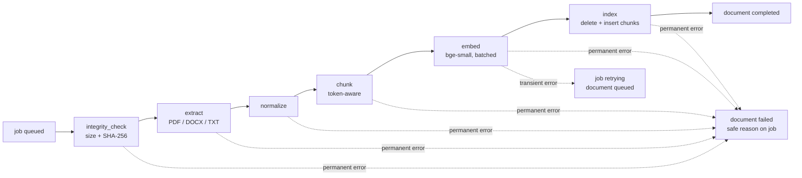

# Document processing (DIP2)

What happens between `POST /documents` and a document becoming searchable. Code:
`app/processing/` (framework-free building blocks) and `app/workers/steps.py` (pipeline
steps executed by the Celery worker through DIP1's `DocumentProcessor`).

## Pipeline

`DocumentProcessor` (DIP1) claims the job (row lock, idempotent re-delivery), runs the
steps and records the outcome. DIP2 added:

- `PipelineContext.state` (`PipelineState`): the extracted content, chunks and vectors are
  handed from step to step in memory for one attempt.
- `DocumentPipeline.run(context, on_step=...)`: before each step the processor writes the
  step name to `document_processing_jobs.stage` in its own short transaction, so
  `GET /documents/{id}/status` shows where a job is or where it stopped (`stage` is kept
  on failure).
- `build_indexing_pipeline(...)` (used by the Celery task). `build_default_pipeline()` is
  still the DIP1 integrity-only pipeline and is used by DIP1's integration tests.

`completed` now means "verified, extracted, chunked, embedded and indexed". No database
transaction is held open while extracting or embedding; the only write transaction is
the final index step.

## Error handling

| Situation | Result | Retried? |
| --- | --- | --- |
| File missing / checksum mismatch | `failed`: "The stored file could not be found" / "...failed integrity verification" | no |
| Empty file | `failed`: "The file is empty" | no |
| Corrupt PDF / DOCX | `failed`: "The PDF could not be read (corrupt or unsupported)" / "The DOCX file could not be read (corrupt or unsupported)" | no |
| Password-protected PDF | `failed`: "The PDF is password-protected" | no |
| DOCX expands beyond `MAX_DOCX_UNCOMPRESSED_BYTES` (zip-bomb guard) | `failed`: "The DOCX file expands to more data than allowed" | no |
| TXT with NUL bytes (binary) | `failed`: "The file does not look like text" | no |
| PDF without a text layer (scan) or document with only whitespace | `failed`: "No extractable text was found. Scanned documents and images are not supported (OCR is not implemented)." | no |
| More than `MAX_CHUNKS_PER_DOCUMENT` chunks | `failed`: "The document is too large to index (more than N chunks)" | no |
| Embedding model dimension differs from `EMBEDDING_DIMENSION` | `failed`: "Embedding is misconfigured on the server; contact the administrator" | no |
| `OSError` (e.g. model download/network), database `OperationalError`, storage errors | job `retrying`, document `queued`, Celery retry with exponential backoff; on the final attempt the job and document are marked `failed`: "Processing failed after several attempts" (no further retry is scheduled) | yes, bounded |
| Any other exception | `failed`: "Processing failed due to an internal error" (details only in logs) | no |
| Celery soft time limit (240 s) | `SoftTimeLimitExceeded` raised in the pipeline -> `failed`: "Processing took too long and was stopped". When it fires inside a network call (e.g. a Hugging Face download) the library may surface it as `OSError`, which is retried; observed in the final compose run with no internet: 4 attempts, then `failed` "Processing failed after several attempts". | depends |
| Hard time limit (300 s) / worker crash | task redelivered (`acks_late`) and re-claimed, at most `CELERY_TASK_MAX_RETRIES + 3` claims, then `failed` | bounded |
| Job still `processing` / `retrying` after `STALE_JOB_TIMEOUT_SECONDS` (900 s), e.g. the database was down on the final attempt | the stale-job reconciler (worker beat, every 300 s) marks it `failed`: "Processing stopped responding and was marked as failed; reprocess to retry" | reprocess |
| Document deleted while processing | index step finds no row and skips; nothing is left behind | - |

Parser exception messages are never stored or returned; logs record only the exception
type. Every job reaches a terminal state: attempts and claims are bounded, and the
reconciler (`app/workers/reconcile.py`, `FOR UPDATE SKIP LOCKED` on job and document,
so it never races a live worker or a reprocess request) fails anything left behind.

## Extraction (`app/processing/extraction.py`)

`DocumentExtractor` protocol: `extract(data: bytes) -> DocumentContent`. An
`ExtractorRegistry` maps the stored content type to an extractor.

| Format | Library | Notes |
| --- | --- | --- |
| PDF | `pypdf` (`strict=False`) | One `PageText` per page with 1-based page numbers; empty pages are kept as empty text so numbering stays correct; a page that fails to extract becomes empty and adds a warning. Encrypted PDFs: an empty user password is tried, otherwise rejected. |
| DOCX | `python-docx` | Body paragraphs and tables in document order (`iter_inner_content`); table rows become `cell | cell`; merged-cell duplicates removed. **Not extracted:** headers, footers, footnotes/endnotes, comments, text boxes and other shapes, embedded objects. Legacy `.doc` is not supported. No page numbers (DOCX pagination happens at render time), so `page_start/page_end` are `null`. ZIP total uncompressed size is checked before parsing; upload validation checks only the ZIP signature. |
| TXT | stdlib | BOM detection (UTF-8, UTF-16), then strict UTF-8, then cp1252 with replacement (recorded as a warning). NUL bytes without a BOM -> rejected as binary. |

`DocumentContent` holds `pages`, `source_format`, `page_count` and `warnings`;
`joined()` concatenates non-empty pages with a blank line and returns each page's
character span, which the chunker uses for page ranges.

OCR: **not implemented**. Image uploads are not on the upload allow-list, and scanned
PDFs fail with an explicit message. Adding OCR (e.g. Tesseract) would mean a new
system dependency and a fallback inside `PdfExtractor` for pages without text.

## Normalization (`app/processing/normalization.py`)

Applied per page, conservative by design (content is not rewritten):

1. `\r\n` / `\r` -> `\n`; Unicode NFC.
2. Remove soft hyphens and zero-width characters; Unicode spaces (NBSP etc.) -> space.
3. Remove C0/C1 control characters except `\n` and `\t`.
4. Collapse runs of spaces/tabs; strip spaces at line ends and starts.
5. Join line-break hyphenation only between lower-case letters (`exam-\nple` -> `example`).
6. Collapse 3+ newlines to one blank line (paragraphs preserved); strip the page.

Single newlines are kept (lists, addresses and table rows depend on them).

## Chunking (`app/processing/chunking.py`)

`RecursiveTokenChunker` implements the `Chunker` protocol:

1. Count tokens of the whole text with a `TokenCounter`. In the worker this is the
   embedding model's own tokenizer (`SentenceTransformerEmbeddingProvider.count_tokens`,
   no special tokens), so `CHUNK_SIZE` is measured in the units the model truncates at
   (512 for bge-small). Tests and the evaluation's hashing baseline use
   `ApproximateTokenCounter` (max of word/punctuation count and characters/4).
2. Split recursively on paragraph breaks, line breaks, sentence ends, clause punctuation,
   whitespace, and finally a binary-search hard split, until each segment fits.
3. Merge segments greedily into chunks of at most `CHUNK_SIZE` tokens. Overlap repeats
   whole trailing segments of the previous chunk up to `CHUNK_OVERLAP` tokens (so the
   real overlap can be smaller, and is zero when one segment exceeds the overlap).
4. Trim whitespace; record `char_start/char_end` (offsets into the normalized, joined
   text, not into the original file), `page_start/page_end` (from the page spans; `null`
   for DOCX/TXT), `token_count` (recounted on the final chunk text) and `index`.
5. Raise `ChunkLimitExceededError` above `MAX_CHUNKS_PER_DOCUMENT`.

Defaults: `CHUNK_SIZE=400`, `CHUNK_OVERLAP=60` tokens (below the 512-token model limit,
leaving room for tokenizer differences). These values were not tuned; the evaluation
script used 120/20 to get several chunks per short fixture document.

## Embeddings (`app/ai/embeddings.py`)

- `EmbeddingProvider` protocol (`app/ai/base.py`): `model_name`, `dimension`,
  `embed(texts)` for passages, `embed_query(text)` for queries.
- `SentenceTransformerEmbeddingProvider`, default model `BAAI/bge-small-en-v1.5`:
  384 dimensions (read from the loaded model and compared with `EMBEDDING_DIMENSION`;
  a mismatch is a configuration error), English, MIT licensed, ~130 MB, CPU friendly.
  Chosen over `all-MiniLM-L6-v2` (also 384-d) because its model card targets retrieval
  and documents a query instruction; this choice was not benchmarked against
  alternatives here.
- Queries get the instruction prefix `EMBEDDING_QUERY_INSTRUCTION`
  ("Represent this sentence for searching relevant passages: "); passages get none.
- Vectors are L2-normalised, so cosine similarity = dot product.
- Lazy, cached loading: one provider per process (`lru_cache` in
  `app/ai/factory.py::create_embedding_provider`), weights loaded on the first embed
  call under a lock; neither the API nor the worker imports torch at startup (tested).
- `embed_in_batches` embeds `EMBEDDING_BATCH_SIZE` texts per call and validates the
  number and size of returned vectors.
- The default provider is `onnx` (ONNX Runtime, no PyTorch in the image). PyTorch is an
  optional `torch` extra from the CPU wheel index (`uv sync --extra torch`), needed only
  for `EMBEDDING_PROVIDER=sentence-transformers` or the reranker.
- The OpenAI embedding adapter from DIP1 still exists but is not selectable: the
  `vector(384)` column is tied to the local model. `EMBEDDING_PROVIDER` accepts `onnx`,
  `remote` and `sentence-transformers` (see [configuration.md](configuration.md)).

## Indexing (`IndexStep`)

One transaction: lock the document row (`SELECT ... FOR UPDATE`), `DELETE` all its
chunks, bulk `INSERT` the new ones, commit. Re-delivery, retries and
`POST /documents/{id}/reprocess` therefore converge to the same chunk set; the unique
constraint `(document_id, chunk_index)` would reject any duplicate. Schema: see
[retrieval.md](retrieval.md#schema).

## Reprocessing

`POST /documents/{id}/reprocess` (owner only, 202) creates a new job for a `completed`
or `failed` document and moves the document to `queued`; 409 while it is queued or
processing. Old chunks remain until the index step replaces them but are not searchable
in the meantime (search requires `status = completed`). Audited as
`document.reprocess_requested`.

## Logging

Events (JSON, with request/document ids; never document text or queries):
`job.stage` (stage), `pipeline.extracted` (format, page_count, char_count, warnings,
duration_ms), `pipeline.chunked` (chunk_count, max_chunk_tokens), `pipeline.embedded`
(count, model, batch_size, duration_ms), `pipeline.indexed` (chunk_count),
`embedding.model_loaded` (model, dimension, max_seq_length, duration_ms),
`extraction.*_unreadable` (error_type only).
