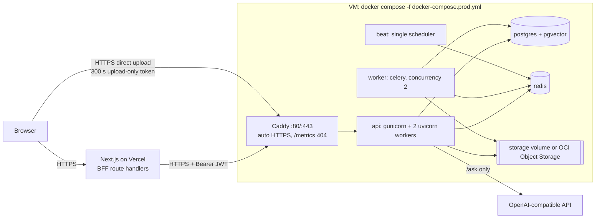

# Production deployment (single VM, Docker Compose, Caddy)

This is the generic runbook for `docker-compose.prod.yml`. It works on any Ubuntu
22.04/24.04 VM (arm64 or amd64). Oracle-specific steps are in
[oracle-cloud-deployment.md](oracle-cloud-deployment.md), the frontend in
[vercel-deployment.md](vercel-deployment.md), backups in
[backup-and-recovery.md](backup-and-recovery.md), and the click-by-click list in
[deployment checklist](deployment-checklist.md).

Status: **CONFIGURED BUT NOT DEPLOYED.** No VM, domain or real OpenAI key was available
while this was built. The stack below was run **locally** with a production-like override
(local Caddy CA, ports 8080/8443, stub LLM). See
[verification report](history/final-project-report.md) for what was verified and how.

## Topology



| Service | Image / command | Network | Published | Limits |
| --- | --- | --- | --- | --- |
| `caddy` | `caddy:2-alpine` (digest pinned) | `web` | 80, 443 | 256 MB |
| `api` | app image, `gunicorn -c python:app.gunicorn_conf` (`WEB_CONCURRENCY=2`) | `web`, `backend` | no (8000 internal) | 3 GB |
| `worker` | `celery worker --concurrency=${WORKER_CONCURRENCY:-2} --max-tasks-per-child=200` | `web`, `backend` | no | 3 GB |
| `beat` | `celery beat` (exactly one) | `backend` | no | 384 MB |
| `migrate` | `alembic upgrade head`, runs once per deploy | `backend` | no | - |
| `postgres` | `pgvector/pgvector:pg16` (digest pinned), tuned for 12 GB | `backend` (internal) | no | 2 GB |
| `redis` | `redis:7-alpine` (digest pinned), password, `noeviction` | `backend` (internal) | no | 512 MB |

`backend` is an `internal: true` network: postgres and redis have no route to or from the
internet. `api` and `worker` are also on `web` for outbound calls (LLM, Object Storage,
model download). Every service has a healthcheck, `json-file` logs rotated at 10 MB x 5,
`no-new-privileges`, `cap_drop: ALL` (app containers), and a memory limit; the sums fit a
2 OCPU / 12 GB VM with headroom for the page cache.

Edge rules (`deploy/caddy/Caddyfile`): automatic Let's Encrypt/ZeroSSL certificates for
`API_DOMAIN`, HTTP to HTTPS redirect, `/metrics` answers 404, request bodies above 11 MB
are rejected before the API, admin API off, HTTP/1.1 + HTTP/2 only.

## Prerequisites

- A VM with a public IPv4 address and inbound TCP 22, 80, 443 allowed (cloud firewall +
  host firewall).
- A hostname that resolves to that address. Without a domain, use one of:
  - `sslip.io` / `nip.io`: `203-0-113-7.sslip.io` resolves to `203.0.113.7` with no
    account. Simple, but the name changes if the IP changes and the services are
    third-party DNS with no SLA.
  - DuckDNS: free account, `<name>.duckdns.org`, update the IP yourself (or with their
    cron script). Stable name across IP changes.
  - A real domain with an `A` record (recommended for anything long-lived).
- Let's Encrypt must reach port 80 (HTTP-01) or 443 (TLS-ALPN-01) on that name.

## First deployment

```bash
# 1. on the VM, as the default sudo user (e.g. ubuntu)
git clone <your-repo-url> /tmp/dip && sudo /tmp/dip/scripts/setup_server.sh
#    Docker + compose plugin, log rotation, firewall 80/443, 4 GB swap,
#    unattended upgrades, user "deploy" (docker group, your SSH key), /opt/dip,
#    /var/backups/dip. Safe to re-run.

# 2. as the deploy user
sudo -iu deploy
git clone <your-repo-url> /opt/dip && cd /opt/dip
git checkout final            # or main, whichever branch you deploy
cp .env.production.example .env.production && chmod 600 .env.production
nano .env.production          # replace every <...>; see "Environment" below

# 3. deploy (backup, build, migrate, start, health check)
scripts/deploy.sh                      # first run: the backup step is skipped (postgres not running yet)
scripts/health_check.sh --url "https://$(grep ^API_DOMAIN= .env.production | cut -d= -f2)"
```

The first build takes several minutes on an Ampere A1 (measured with the earlier PyTorch-based
image under QEMU emulation at about 3.5 minutes; the default image now uses ONNX Runtime). The first
document triggers the ~130 MB embedding-model download into the `model_cache` volume.

## Environment

All keys are listed with comments in [.env.production.example](../.env.production.example).
`scripts/lib_prod.sh` refuses to run while any value still starts with `<`, and warns if
the file is readable by others.

| Key | Required | Notes |
| --- | --- | --- |
| `API_DOMAIN` | yes | hostname Caddy serves and gets a certificate for |
| `CADDY_TLS` | yes | an e-mail for ACME expiry notices; `internal` only for local tests |
| `CORS_ALLOWED_ORIGINS` | yes | the Vercel production origin, e.g. `https://dip.vercel.app` (https only, no `*`) |
| `JWT_SECRET_KEY`, `POSTGRES_PASSWORD`, `REDIS_PASSWORD` | yes | `python3 -c "import secrets; print(secrets.token_urlsafe(48))"` |
| `OPENAI_API_KEY` | no | empty: `/ask` returns 503 "not configured"; upload, processing and search work |
| `LLM_MODEL` | no | default `gpt-4o-mini` |
| `STORAGE_BACKEND` + `STORAGE_S3_*` | no | `local` (volume) or `oci` (Object Storage), see [backup-and-recovery.md](backup-and-recovery.md) |
| `WEB_CONCURRENCY`, `WORKER_CONCURRENCY`, `TORCH_NUM_THREADS` | no | 2 / 2 / 1 on 2 OCPUs |
| `RATE_LIMIT_*` | no | public-demo defaults: register 10/hour, login 10/minute, login per e-mail 5/minute, upload 30/day, search 60/minute, ask 20/hour, reprocess 20/day |
| `BACKUP_*` | no | directory, retention, optional GPG recipient and bucket |

`APP_ENV=production` makes the API refuse to start with `DEBUG`, `LOG_LEVEL=DEBUG`,
non-https CORS origins, an http `LLM_BASE_URL`, the in-memory rate limiter, or missing /
placeholder secrets. API docs (`/docs`) are off.

## Updating

```bash
cd /opt/dip && scripts/deploy.sh                 # pull the current branch (fast-forward only)
scripts/deploy.sh --ref <tag-or-commit>          # deploy or roll back to a specific ref
```

`deploy.sh` takes a lock, refuses a dirty checkout, fetches and checks out the ref,
takes a database backup, rebuilds the app image (`--pull` for base images), runs
`alembic upgrade head` in a one-off `migrate` container, restarts api/worker/beat/caddy
and waits for their healthchecks, then runs `health_check.sh` and, if `SMOKE_EMAIL` and
`SMOKE_PASSWORD` are set, `production_smoke_test.py`. It prints the previous commit for
a rollback. A deploy with `--ref <sha>` (what the GitHub workflow does) leaves the
checkout detached; a later `deploy.sh` without `--ref` then redeploys the same commit, so
pass `--ref <branch>` to follow a branch again. Migrations are forward-only in practice: rolling back code past a migration
needs the matching restore from the pre-deploy backup.

GitHub Actions can run the same command over SSH (`.github/workflows/deploy.yml`, see
[CI/CD](#cicd)).

## Operations

```bash
C="docker compose -f docker-compose.prod.yml --env-file .env.production"
$C ps                                  # all services healthy
$C logs -f --tail=100 api worker       # JSON logs (no secrets, no document text)
scripts/health_check.sh --url https://$API_DOMAIN
$C exec api python -m app.cli create-admin --email you@example.com
$C exec api python -m app.cli reconcile-stale-jobs
$C exec api python -c "import urllib.request;print(urllib.request.urlopen('http://127.0.0.1:8000/metrics').read()[:300])"
python3 scripts/production_smoke_test.py --base-url https://$API_DOMAIN --register
```

`production_smoke_test.py` needs only the Python standard library. It creates (or
reuses) a user from `SMOKE_EMAIL` / `SMOKE_PASSWORD`, checks health, `/metrics` 404,
login, the upload-only token (and that it is refused elsewhere), uploads a small TXT
with a unique marker, waits for `completed`, finds it with keyword search, optionally
calls `/ask` (`--with-llm`; `--require-llm` fails if it is not configured), deletes the
document and checks the 404.

## CI/CD

- `.github/workflows/ci.yml`: lint (actionlint, ruff, format, mypy), tests (pgvector +
  Redis services, coverage gate 90%, Alembic cycle), pip-audit, Docker build + compose /
  Caddyfile validation, shellcheck, frontend (lint, typecheck, build) and an optional
  Playwright job (`workflow_dispatch` with `e2e: true`).
- `.github/workflows/deploy.yml`: on push to `main`/`final` (or manual dispatch with a
  ref) it calls `ci.yml` first, then, in the `production` environment, connects with
  `ORACLE_SSH_PRIVATE_KEY` to `ORACLE_USER@ORACLE_HOST`, pins the host key from
  `ORACLE_SSH_KNOWN_HOSTS` (`StrictHostKeyChecking=yes`), runs
  `cd /opt/dip && scripts/deploy.sh --ref <sha>` and checks
  `${{ vars.API_PUBLIC_URL }}/health/ready`. If `ORACLE_HOST` is not set the deploy job
  is skipped, so forks and fresh clones stay green.

| Secret / variable | Value |
| --- | --- |
| `ORACLE_HOST` (secret) | VM public IP or hostname |
| `ORACLE_USER` (secret) | `deploy` |
| `ORACLE_SSH_PRIVATE_KEY` (secret) | a dedicated ed25519 key whose public half is in `~deploy/.ssh/authorized_keys` |
| `ORACLE_SSH_KNOWN_HOSTS` (secret) | output of `ssh-keyscan -t ed25519 <host>` verified against the console fingerprint |
| `API_PUBLIC_URL` (variable) | `https://<API_DOMAIN>` |

Both workflows pass actionlint locally. **They have never run on GitHub** (no remote
was configured while building this): NOT VERIFIED.

## Capacity notes (2 OCPU / 12 GB)

- Each API worker and each Celery worker process loads the embedding model
  (about 0.5 GB RSS each, measured with the earlier PyTorch provider). 2 + 2 processes plus Postgres (`shared_buffers=512MB`) and
  Redis (`maxmemory 400mb`) stay well below 12 GB; swap is a safety net only.
- `TORCH_NUM_THREADS=1` per process avoids CPU oversubscription with 4 model-loading
  processes on 2 OCPUs (see [performance.md](performance.md) for the effect of
  oversubscription).
- Ingestion is CPU-bound; large PDFs take seconds to minutes. Celery soft/hard limits
  are 240/300 s per document.

## Local production-like run

`scripts/e2e_prod_local.sh` builds and starts the production compose file with
`docker-compose.prod.e2e.yml` (Caddy internal CA on 8080/8443, `api.localhost`, a stub
LLM behind HTTPS, generous rate limits), exports the Caddy root certificate, builds and
starts the frontend against `https://api.localhost:8443`, and runs the Playwright suite.
`scripts/e2e_prod_local.sh --down` removes the stack and its volumes. It needs
`127.0.0.1 api.localhost app.localhost` in the hosts file on some systems.
