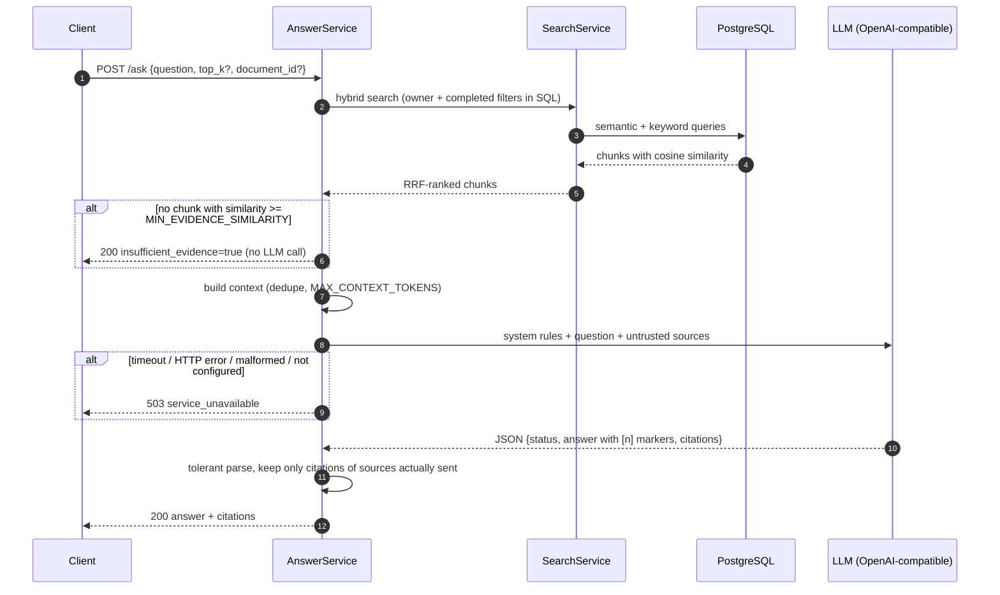

# Question answering with citations (DIP2)

`POST /ask`. Code: `app/services/answer_service.py`, `app/services/rag_prompt.py`,
`app/ai/llm.py`, `app/api/routes/search.py`.

## Flow



1. **Retrieval is mandatory.** The question is validated like a search query and
   retrieved in `hybrid` mode with the caller's filters (`top_k` default `ASK_TOP_K`,
   8; `/search` keeps `TOP_K`).
2. **Evidence gate.** The LLM is called only if the best passage reaches
   `MIN_EVIDENCE_SIMILARITY` (cosine). Otherwise the response is
   `insufficient_evidence: true`, `insufficient_reason: "below_threshold"`, a fixed
   message, `model: null`, and **no LLM call** (tested with a mock that records calls).
   **Document-level and scoped questions** use the lower `ASK_SCOPED_MIN_SIMILARITY`
   (0.20) instead: a question scoped to one document (`document_id`, e.g. picked in the
   Ask UI) or about a document as a whole ("summarize this document", "what is this
   document about?", "key points", `is_document_level_question`). Measured on
   2026-10-19 with `scripts/check_ask_real.py` against the local stub stack: "What is this
   document about?" had a best similarity of **0.415** and the off-topic "What is the
   boiling point of mercury?" **0.422**, so no similarity threshold separates them; the
   model decides (structured `status: "insufficient"` -> `model_declined`). Off-topic
   questions without document scope keep the strict gate. Logged as `gate`
   (`default` / `document_level` / `scoped`) with `best_similarity`.
3. **Context builder** (`build_context`): once the gate passed, every passage with
   similarity >= `min(ASK_CONTEXT_MIN_SIMILARITY, MIN_EVIDENCE_SIMILARITY)` (0.40) is a
   candidate, so supporting passages just below the gate reach the model (scoped
   questions: everything retrieved from that document down to the scoped gate; unscoped
   document-level questions: never below 0.40 except the best passage). Drops chunks
   identical to an earlier one or inside an already selected chunk (overlap); stops at
   `MAX_CONTEXT_TOKENS` (4000). The best source is always kept. Sources are numbered
   `1..n`.
4. **Prompt** (`build_messages`): text lives in `app/prompt/` (see below).
5. **LLM call** through `LLMProvider`, requesting OpenAI structured outputs (strict JSON
   schema `app/prompt/response_schema.json`, `LLM_STRUCTURED_OUTPUT=true`). An endpoint
   that answers 400/422 is retried once without `response_format`, which then stays off
   for that provider. Failures -> 503; `/search` keeps working (tested).
6. **Parsing** (`app/services/answer_parsing.py`, never raises): strict JSON, JSON in a
   ```` ```json ```` fence or embedded after prose, alternative field names, or plain
   text with `[n]` markers. Marker variants `[1, 2]`, `[1-3]`, `[S1]`, `[Source 1]`,
   `[^1]`, `【1】`, `(Source 1)` are normalised to `[n]`; numbers above 100 (`[2024]`)
   are left alone.
7. **Citation validation**: markers for sources that were not sent are removed
   (warning `invalid_citations_removed`); the answer is kept while at least one valid
   citation remains. `status: "partial"` (or an "insufficient" reply that still cites
   sources) returns the supported part with `partial: true`, `missing_information` and
   the warning `partial_answer`.
8. **Insufficient evidence** is returned only for one of four logged reasons:
   `below_threshold` (gate), `model_declined` (model said insufficient and cited
   nothing), `parse_failed` (empty reply / refusal / no answer text), or
   `no_valid_citations` (an answer without any valid citation is treated as ungrounded
   and not shown).

## Why every answer was "Not enough evidence" (fixed 2026-10-18)

Reported with real gpt-4o-mini: `ask.insufficient_evidence ... retrieved: 5,
llm_called: true` for every question. In the previous code that log line with
`llm_called: true` was emitted **only** when the model reply began with the sentinel
`INSUFFICIENT_EVIDENCE` or was empty; unrecognised citation formats would have produced
an answer with the warning `answer_has_no_citations` instead. So the model itself
declined. Contributing causes found in the code and calibration data:

- The old prompt was all-or-nothing ("if the excerpts do not contain enough
  information, reply with exactly INSUFFICIENT_EVIDENCE and nothing else"), repeated
  as the last line of the user message, at temperature 0. Anything short of a complete
  answer was declined.
- Every passage had to pass 0.48 individually, so the model often saw one or two weak
  excerpts. Document-level questions ("what is this document about?") score only
  0.507-0.584 with bge-small.
- The Docker stub LLM always returned a static cited answer, which masked the problem.

The actual gpt-4o-mini replies could not be inspected here (no key in this environment),
so this is inferred from the code path; the replay fixture `tests/fixtures/llm_replies.json`
covers the sentinel reply, structured, fenced, prose+JSON, alternative markers, refusals
and empty content (hand-written replicas, **not** captured OpenAI output).

**Check it yourself (one command, costs a few cents):**
`python scripts/check_ask_real.py` with the stack running and `OPENAI_API_KEY` set. It
prints `outcome`, `reason`, citation numbers and the prompt version per question and
exits 1 if an on-topic question is not answered with a citation. Use
`--pdf your.pdf -q "your question"` for your own document. If an answer is still
declined, the API log line `ask.insufficient_evidence` now names the reason.

## Threshold calibration

`scripts/calibrate_evidence_threshold.py` embeds the evaluation documents
(CHUNK_SIZE 400) and reports the top-1 cosine similarity per query with
`BAAI/bge-small-en-v1.5`. Run on the dev box (2026-10-18):

| Queries | n | min | median | max |
| --- | --- | --- | --- | --- |
| on-topic (eval set) | 18 | 0.507 | 0.664 | 0.809 |
| document-level ("what is this about?") | 4 | 0.507 | 0.527 | 0.584 |
| off-topic (general knowledge) | 6 | 0.388 | 0.419 | 0.451 |

The gate stays at `0.48`: it still lies between the highest off-topic and the lowest
on-topic score. What changed is that the gate now applies to the best passage only and
supporting passages down to 0.40 are sent along. The gap is small and the sample tiny;
recalibrate when the model, chunk size or corpus changes. The tests use 0.15 because
the hashing test embedder produces lower similarities.

## Prompt layout (`app/prompt/`)

| File | Purpose |
| --- | --- |
| `system.md` | System message: grounded analyst rules (grounding, `[n]` citations, partial answers, injection defence, refuse only when nothing is relevant, answer in the question's language) |
| `answer_instructions.md` | Output contract appended after the sources (`$source_count` substituted) |
| `insufficient_evidence.md` | The user-facing "not enough evidence" message |
| `response_schema.json` | Strict JSON schema for structured outputs |
| `__init__.py` | Cached loader (`importlib.resources`), strips `<!-- -->` comments, `PROMPT_VERSION` |

`PROMPT_VERSION` is returned in every `/ask` response (`prompt_version`) and logged.
`.dockerignore` excludes `*.md` but re-includes `app/prompt/*.md` (tested).

User message:

```
<question>
...question, with & < > escaped...
</question>

<untrusted_sources>
<source id="1" document="policy.pdf" pages="2-3">
...chunk text, with & < > escaped...
</source>
...
</untrusted_sources>

...answer_instructions.md...
```

Retrieved text never goes into the system message. Escaping means a document
containing `</source></untrusted_sources>` cannot close the wrapper (tested).

## Citations

- The model cites numbers (`[1]`), not ids; the server maps them back to chunks it
  actually sent. Each citation has `number` (1..n) and `source_id` (`S1`, kept for
  compatibility).
- Each citation returns `chunk_id`, `document_id`, `filename`, `chunk_index`,
  `page_start`, `page_end`, `char_start`, `char_end` and a 300-character `snippet` -
  all taken from the database row, never from the LLM output.
- Citations prove which retrieved passage the model *pointed at*; they do not prove the
  sentence is entailed by that passage. No entailment check exists (**Not measured**).

## LLM provider

`LLMProvider` protocol (`model_name`, `complete(messages, *, json_schema=None)`).
`OpenAICompatibleLLMProvider` (`app/ai/llm.py`) posts to
`{LLM_BASE_URL}/chat/completions` with `httpx2` (the HTTP client the pinned OpenAI SDK
uses), `Authorization: Bearer <OPENAI_API_KEY>`, `model=LLM_MODEL`, `temperature`
(`LLM_TEMPERATURE`, default 0), `max_tokens` (`LLM_MAX_OUTPUT_TOKENS`) and a hard
`LLM_TIMEOUT_SECONDS` timeout. No retries (the user is waiting; 503 tells the client
to retry). Errors become `LLMError` with generic messages; logs carry the model, the
HTTP status or exception type and token usage - never the key, prompt or response
body (tested with captured logs).

`LLM_PROVIDER=none` or a missing/placeholder `OPENAI_API_KEY` -> `/ask` returns 503
"Question answering is not configured" (after retrieval, so insufficient-evidence
answers still work without an LLM). Nothing contacts the LLM at startup, in health
checks or in tests (tests inject `MockLLM`). The provider is created lazily and cached
per configuration (one connection pool per process).

Some reasoning-model endpoints reject `max_tokens` or a non-default `temperature`;
with such a model `/ask` returns 503 and the log shows the upstream HTTP status. Use a
chat model (default `gpt-4o-mini`) or an endpoint that accepts these parameters.

### Verification

| Path | Status |
| --- | --- |
| Evidence gate, citation validation, injection escaping, LLM errors -> 503 | PASS (unit/API tests with `MockLLM`) |
| Full HTTP path through `OpenAICompatibleLLMProvider` in Docker | PASS against the local stub (`docker-compose.stub-llm.yml`): answer with `[1]`/`[2]`, forged `[99]` removed (`STUB_LLM_STYLE` structured / fenced / text / legacy), off-topic question answered as insufficient evidence without an LLM call |
| Replayed gpt-4o-mini-style replies through the real provider (`httpx2.MockTransport`) | PASS (`tests/unit/test_llm_replay.py`, 18 cases; hand-written replicas) |
| Real OpenAI model | NOT VERIFIED in this environment (the key exists only on the user's PC). Run `python scripts/check_ask_real.py`; see also [manual-testing.md](manual-testing.md#real-openai-test-optional-costs-money) |

## Response

```json
{
  "answer": "Customers may return unused items within 30 days of delivery [1].",
  "insufficient_evidence": false,
  "partial": false,
  "missing_information": null,
  "insufficient_reason": null,
  "prompt_version": "2026-10-18.2",
  "citations": [{"number": 1, "source_id": "S1", "chunk_id": "...", "document_id": "...",
                 "filename": "smoke.pdf", "chunk_index": 0, "page_start": 1,
                 "page_end": 1, "char_start": 0, "char_end": 204, "snippet": "..."}],
  "sources_considered": 1,
  "model": "gpt-4o-mini",
  "warnings": []
}
```

(Illustrative shape, not captured output.)

## Logging

`ask.insufficient_evidence` (reason, retrieved, best_similarity, threshold, llm_called,
parse_mode, model_status, prompt_version), `ask.completed` (retrieved, sources_sent,
citations, invalid_citations_removed, partial, parse_mode, question_length, duration_ms), `ask.llm_failed` (error_type), `llm.completed` (model, duration_ms, token
usage, finish_reason, structured_output), `llm.structured_output_unsupported`,
`llm.no_content` (refusal flag), `llm.timeout` / `llm.http_error` / `llm.transport_error` /
`llm.malformed_response`. No question or document text is logged.
